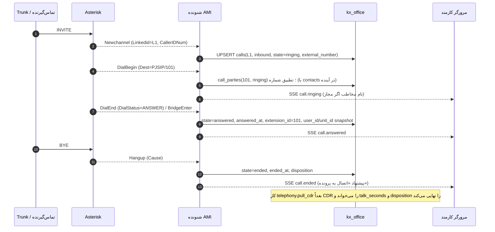
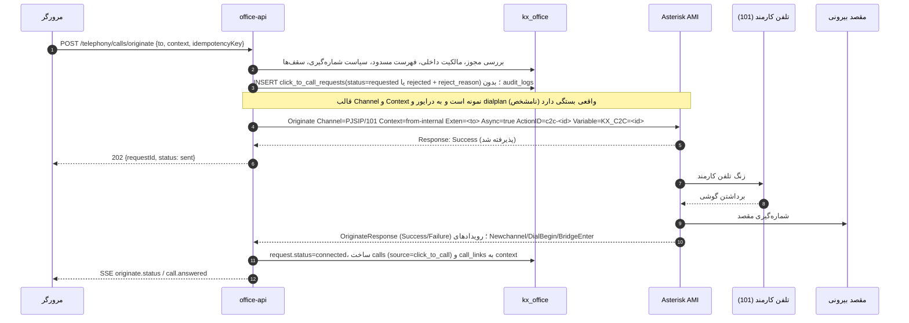

# چرخه حیات تماس

> نام رویدادهای AMI بر اساس Asterisk 12 به بالا است (`DialBegin`، `DialEnd`، `BridgeEnter`، `Hangup`، `Cdr`، `DeviceStateChange`). نسخه Asterisk نصب‌شده **نامشخص** است؛ اگر قدیمی‌تر باشد (مثلاً ۱۱)، نام‌ها (`Dial`، `Bridge`) فرق می‌کند و نگاشت در آداپتور تغییر می‌کند، نه در دامنه.

## ۰. فازبندی

| فاز | منبع داده | آنچه ساخته می‌شود |
|---|---|---|
| ۲ | فقط CDR فقط‌خواندنی (بدون اتصال ماندگار AMI) | `calls` با `source='cdr'` و `completeness='cdr_only'`، `call_legs` از ردیف‌های CDR، `call_parties`، پیوند به پرونده |
| ۳ | شنونده AMI + CDR برای تطبیق نهایی | تماس زنده، `call_events`، وضعیت داخلی، SSE، تماس با یک کلیک |

بخش‌های ۳ تا ۵ (توالی رویداد زنده) از فاز ۳ فعال می‌شوند؛ بخش ۶ (برداشت CDR) و بخش ۹ (مدل پردازش) از فاز ۲.

## ۱. شناسه‌ها و همبستگی

- هر کانال یک `Uniqueid` دارد؛ همه کانال‌های یک تماس منطقی یک `Linkedid` مشترک دارند. ردیف `calls` با `(pbx_key, pbx_linkedid)` یکتا است.
- تماس با یک کلیک: `ActionID = c2c-<correlation_id>` و متغیر کانال `KX_C2C=<correlation_id>` در `Originate` (`click_to_call_requests.correlation_id`)؛ شنونده با دیدن این متغیر (`VarSet` یا `Newchannel` + `Getvar` در صورت نیاز) درخواست را به `calls` وصل می‌کند.
- CDR: ستون `linkedid` (در صورت وجود در جدول CDR نسخه نصب‌شده؛ **نامشخص**) یا `uniqueid` برای تطبیق با `calls`.

## ۲. تعیین جهت و طرف سازمان

| شرط | جهت |
|---|---|
| کانال اول از Trunk (نام کانال با پیشوند Trunkهای `settings.trunks`) و مقصد داخلی/صف/IVR | `inbound` |
| کانال اول از داخلی و مقصد از Trunk | `outbound` |
| هر دو طرف داخلی | `internal` |
| هیچ‌کدام قابل تشخیص نیست | `unknown` (برای بازبینی) |

`extension_id`، `user_id` و `unit_id` از **تخصیص فعال در لحظه شروع تماس** (`extension_assignments` با `valid_from <= started_at < coalesce(valid_to, ∞)`) گرفته و ذخیره (Snapshot) می‌شوند تا جابه‌جایی بعدی کارمند، گزارش گذشته را تغییر ندهد.

## ۳. تماس ورودی

- صف یا زنگ گروهی: هر `DialBegin` به یک داخلی یک ردیف `call_parties` با نقش `ringing` یا `queue_member`؛ پاسخ‌دهنده `answered=true` و `calls.extension_id` می‌شود.
- تماس بی‌پاسخ: `Hangup` بدون `BridgeEnter` → `disposition='no_answer'` یا `busy` بر اساس `DialStatus`. اعلان اختیاری `telephony.missed_call` به داخلی‌های زنگ‌خورده.
- انتقال (Transfer): رویدادهای `BlindTransfer`/`AttendedTransfer` → `call_parties` با نقش `transfer_target`؛ `calls.extension_id` به آخرین پاسخ‌دهنده تغییر می‌کند و اولی در `call_parties` می‌ماند.

## ۴. تماس خروجی (از تلفن کارمند)

مانند ورودی، با این تفاوت که کانال اول داخلی است و `Newchannel` با `Exten` شماره مقصد. `external_number` از `DialBegin.DestCallerIDNum` یا `Exten` نرمال می‌شود.

## ۵. تماس با یک کلیک

- هر مرحله وضعیت همان ردیف `click_to_call_requests` را جلو می‌برد (`sent` → `agent_ringing` → `connected` → `completed`) تا نتیجه هر عملیات قابل گزارش باشد.
- اگر کارمند گوشی را برندارد: `OriginateResponse` با `Reason` ۳ یا ۵ → `failed` با `error_code='agent_no_answer'`؛ تماسی به بیرون زده نمی‌شود.
- `Context` و قالب `Channel` (`PJSIP/` یا `SIP/`) از تنظیمات اتصال خوانده می‌شود و **باید با مدیر مرکز تلفن تأیید شود** تا مسیریابی و محدودیت‌های تماس بیرونی Issabel (Outbound Routes) دور زده نشوند. Originate همیشه به Context عادی داخلی‌ها می‌رود تا همان قوانین مسیریابی و دسترسی اعمال شوند.

## ۶. قطع تماس و ثبت تاریخچه

1. `Hangup` آخرین کانال یک `Linkedid` → `state='ended'`، `ended_at`، محاسبه موقت `ring_seconds` و `talk_seconds`.
2. کار دوره‌ای `telephony.pull_cdr` (پیش‌فرض هر ۲ دقیقه) ردیف‌های جدید CDR را از مکان‌نما می‌خواند (مکان‌نما: `calldate` + `sequence`/`uniqueid` در `integrations.state`، با هم‌پوشانی ۵ دقیقه‌ای برای ردیف‌های دیر نوشته‌شده)، در `cdr_records` با `ON CONFLICT DO NOTHING` درج و با `calls` تطبیق می‌دهد:
   - تماس موجود: `talk_seconds` و `disposition` از CDR نهایی و `cdr_reconciled=true`.
   - تماس بدون ردیف (شنونده قطع بوده): ایجاد `calls` با `source='cdr'`.
3. تماس‌هایی که بیش از `settings.staleLiveMinutes` (پیش‌فرض ۱۲۰ دقیقه) `ended` نشده‌اند و CDR آن‌ها آمده، بسته می‌شوند؛ اگر CDR هم نیامده، `ended` با `disposition=NULL` و علامت بازبینی.
4. پس از پایان، UI پیشنهاد اتصال به پرونده را نشان می‌دهد: نامه‌ها و اسنادی که کاربر می‌بیند (و پس از ساخت دفترچه، مخاطبانی که شماره آن‌ها با `external_number` منطبق است).

## ۷. تطبیق خودکار با مخاطب

> این بخش فقط پس از ساخت دفترچه مخاطبان فعال می‌شود (تصمیم D5). تا آن زمان `resolveNumber` فقط شماره‌های داخلی را به کارمند تطبیق می‌دهد و پیشنهاد پیوند فقط از نامه‌ها و اسنادی است که کاربر می‌بیند.

- نرمال‌سازی شماره (`numbers.ts`): حذف فاصله و خط تیره، ارقام فارسی به لاتین (مانند `fa_normalize`)، `0098`/`98`/`0` به `+98`، شماره ثابت بدون پیش‌شماره با `settings.defaultAreaCode` (مثلاً تهران `21`).
- `contact_phones.number = calls.external_number` → پیوند `match_method='auto_number'` فقط اگر **یک** مخاطب منطبق باشد؛ در غیر این صورت فقط پیشنهاد.
- شماره‌های مخفی (`anonymous`، خالی) هرگز تطبیق نمی‌شوند.

## ۸. موارد مرزی

| مورد | رفتار |
|---|---|
| رویداد تکراری پس از اتصال مجدد AMI | `call_events` یکتا روی `event_hash` (مستقل از ترتیب دریافت)؛ UPSERT `calls` ناهمگام‌پذیر (فقط پیشروی وضعیت: `ringing → answered → ended`، هرگز برگشت) |
| ترتیب نادرست رویدادها | زمان رویداد از `Timestamp` AMI (در صورت فعال بودن `timestampevents`) و نه زمان دریافت |
| قطع شنونده در وسط تماس | CDR بعداً تماس را تکمیل می‌کند (بند ۶) |
| داخلی بدون تخصیص | `user_id` و `unit_id` خالی؛ در گزارش «بدون تخصیص» |
| تماس داخلی بین دو کارمند | یک ردیف `calls` با `direction='internal'` و هر دو در `call_parties`؛ هر دو آن را در «تماس‌های من» می‌بینند |
| تغییر ساعت سرورها | هشدار در `GET /telephony/health` اگر اختلاف ساعت PBX و سرور اتوماسیون بیش از ۳۰ ثانیه باشد (از `Timestamp` رویدادها) |

## ۹. مدل پردازش: تکرار، تماس ناقص و تماس چندبخشی

### ۹.۱ تجمیع بخش‌ها

- هر کانال Asterisk یک بخش (`call_legs`) است. تماس منطقی = همه بخش‌هایی که `Linkedid` مشترک دارند. انتقال، صف، زنگ گروهی و Local channel همه بخش‌های جدا در همان تماس می‌سازند.
- **از CDR (فاز ۲):** چند ردیف CDR با یک `linkedid` به یک ردیف `calls` تجمیع می‌شوند: `started_at` = کمینه `calldate`؛ `answered_at` = نخستین بخش پاسخ‌داده؛ `talk_seconds` = مجموع `billsec` بخش‌های سمت سازمان بدون هم‌پوشانی؛ `disposition` = `answered` اگر هر بخشی پاسخ گرفته، وگرنه وضعیت بخش آخر؛ `extension_id` = آخرین داخلی پاسخ‌دهنده. اگر جدول CDR ستون `linkedid` نداشته باشد (C2)، همبستگی فقط بر اساس `uniqueid` نخستین بخش و `peer` ممکن است و تماس‌های دارای انتقال ممکن است چند ردیف شوند؛ این حالت با `completeness='needs_review'` علامت می‌خورد (**نیازمند تأیید**).
- **از AMI (فاز ۳):** شنونده بخش‌ها را در حافظه بر اساس `Linkedid` نگه می‌دارد و فقط تغییرات معنادار (شروع، زنگ، پاسخ، پایان بخش) را در پایگاه می‌نویسد.

### ۹.۲ حذف تکرار

| منبع | کلید | رفتار |
|---|---|---|
| CDR | `cdr_records (pbx_key, cdr_uniqueid, cdr_sequence)` | `ON CONFLICT DO NOTHING`؛ مکان‌نما با هم‌پوشانی ۵ دقیقه؛ اجرای دوباره هیچ اثری ندارد |
| رویداد AMI | `call_events.event_hash` | تکرار پس از اتصال مجدد نادیده؛ شمارنده `telephony_events_duplicate_total` |
| تماس | `calls (pbx_key, pbx_linkedid)` | UPSERT فقط‌پیش‌رو: وضعیت هرگز به عقب برنمی‌گردد (`ringing → answered → ended`) و زمان‌ها فقط دقیق‌تر می‌شوند |
| بخش | `call_legs (call_id, pbx_uniqueid)` | UPSERT |
| درخواست تماس | `click_to_call_requests (user_id, idempotency_key)` و `correlation_id` | پاسخ قبلی برگردانده می‌شود |

### ۹.۳ تماس ناقص

| حالت | `completeness` | رفتار |
|---|---|---|
| در جریان | `live` | — |
| زنده + CDR منطبق آمد | `complete` | مقادیر CDR نهایی‌اند |
| فقط CDR (فاز ۲ یا شنونده قطع بوده) | `cdr_only` | معتبر برای گزارش |
| پایان دیده نشد و CDR پس از `staleLiveMinutes` هم نیامد | `partial` | `state='ended'`، `disposition=NULL`؛ در گزارش جدا نمایش داده می‌شود |
| داده متناقض (جهت نامشخص، دو داخلی پاسخ‌دهنده هم‌زمان، نبود linkedid) | `needs_review` | دارندگان `telephony.manage` فقط شمار و شناسه این تماس‌ها را برای عیب‌یابی فنی می‌بینند و جزئیات فقط با دیدن تماس (`callVisibleSql`)؛ کاربران مرتبط آن را با برچسب «ناقص» می‌بینند |

### ۹.۴ لاگ عمومی

لاگ سرور برای هر تماس فقط `call_id`، `correlation_id`، نوع رویداد و نتیجه را ثبت می‌کند؛ شماره‌ها پوشانده و بدون متغیرهای کانال و نام تماس‌گیرنده.
