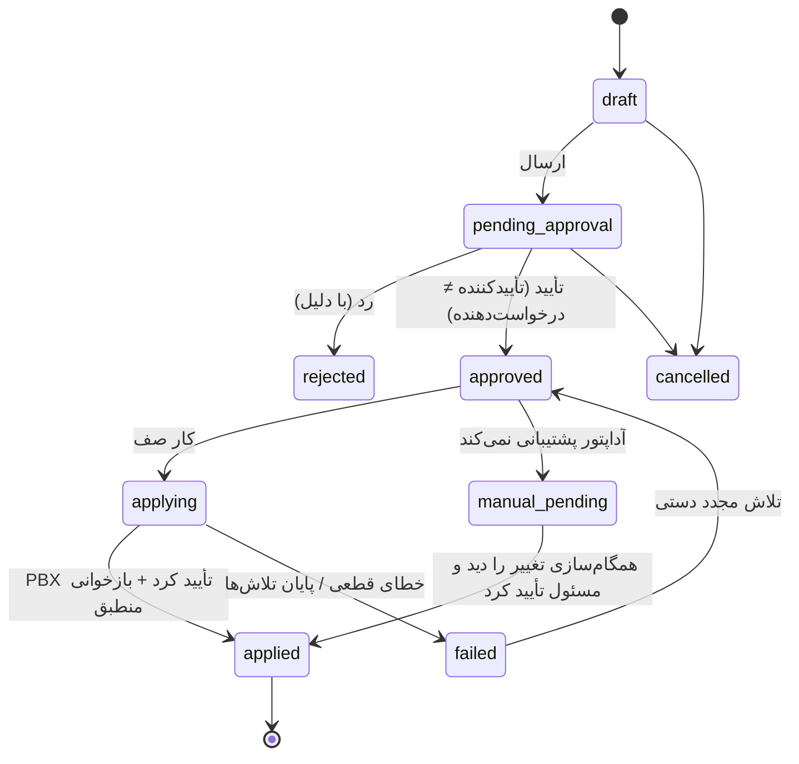

# مشخصات مدیریت داخلی‌ها و نگاشت کاربران

> **فازبندی:** بخش‌های ۳.۱، ۳.۳، ۳.۴ و ۳.۵ (تاریخچه تخصیص) در فاز ۱ هستند و هیچ‌کدام چیزی در Issabel تغییر نمی‌دهند. نمایش وضعیت عملیاتی (۳.۶) به فاز ۳ و شنونده AMI وابسته است و تا آن زمان `unknown` است. بخش ۳.۲ و ۵ (ایجاد، ویرایش، غیرفعال‌سازی و Maker-Checker) در فاز ۴ هستند و فقط وقتی پیاده می‌شوند که رابط مدیریتی نسخه واقعی اثبات شود (`implementation-roadmap.md` بخش ۳). معیارهای پذیرش قابل آزمون با شناسه‌های `P1-*` و `P4-*` در نقشه راه آمده‌اند.

## ۱. مفاهیم

| مفهوم | تعریف | منبع حقیقت |
|---|---|---|
| **داخلی (Extension)** | شماره داخلی تعریف‌شده در Issabel با تنظیمات آن (نام نمایشی، درایور، صندوق صوتی، ...) | Issabel |
| **آینه داخلی** | ردیف `pbx_extensions` در اتوماسیون؛ آخرین وضعیت دیده‌شده از PBX | همگام‌سازی |
| **تخصیص** | انتساب یک داخلی به کارمند و/یا واحد و/یا سمت در بازه زمانی | اتوماسیون |
| **درخواست تغییر** | ایجاد، ویرایش یا غیرفعال‌سازی داخلی در PBX که باید تأیید و اعمال شود | اتوماسیون (تا زمان اعمال) |

## ۲. سه وضعیت جدا برای هر داخلی

| وضعیت | فیلد | مقادیر | منبع |
|---|---|---|---|
| همگام‌سازی پیکربندی | `pbx_extensions.sync_status` | `in_sync` · `pending_change` (درخواست تأییدشده در حال اعمال) · `drift` (در PBX با آخرین وضعیت شناخته‌شده فرق دارد) · `missing_on_pbx` · `error` | کار همگام‌سازی |
| عملیاتی (دستگاه) | `pbx_extensions.device_state` | `unknown` · `not_in_use` · `in_use` · `busy` · `ringing` · `on_hold` · `unavailable` · `invalid` | رویداد AMI `DeviceStateChange`/`ExtensionStatus` |
| چرخه حیات در اتوماسیون | `pbx_extensions.lifecycle` | `active` · `disabled` · `deleted` | اتوماسیون + PBX |

وضعیت تماس جدا در جدول `calls` است (`call-lifecycle.md`).

## ۳. قابلیت‌ها

### ۳.۱ مشاهده فهرست

- فهرست با فیلتر: شماره، نام، واحد، وضعیت همگام‌سازی، وضعیت عملیاتی، بدون تخصیص، غیرفعال.
- هر ردیف: شماره، نام نمایشی در PBX، کارمند/واحد/سمت فعلی، سه وضعیت، زمان آخرین همگام‌سازی، آخرین خطا.
- همگام‌سازی دستی «اکنون همگام کن» (کار صف، نه درخواست هم‌زمان).
- مجوز: `extension.view` با دامنه واحد (کاربر با دامنه واحد فقط داخلی‌های تخصیص‌یافته به زیردرخت واحد خود را می‌بیند؛ داخلی بدون تخصیص فقط برای دارندگان دامنه سراسری).

### ۳.۲ ایجاد، ویرایش و غیرفعال‌سازی (فاز ۴)

پیش‌شرط: `PbxConfigAdapter.capabilities()` آن عمل را پشتیبانی کند. در غیر این صورت، همان فرم «درخواست» ثبت می‌شود اما اعمال آن دستی است (حالت تیکت؛ بخش ۵).

| عمل | فیلدهای قابل تغییر (حداقل، منوط به API) | قواعد |
|---|---|---|
| ایجاد (`extension.create`) | شماره، نام نمایشی، Outbound CID (اختیاری)، صندوق صوتی روشن/خاموش، گروه دسترسی تماس بیرونی (منوط به dialplan). فیلدهای واقعی به رابط تأییدشده بستگی دارند (**نیازمند تأیید**) | شماره در محدوده مجاز (`settings.extensionRanges`)؛ یکتا در آینه و در PBX (قبل از اعمال در PBX بررسی می‌شود) |
| ویرایش (`extension.update`) | همان فیلدها به‌جز شماره | تغییر شماره = ایجاد جدید + انتقال تخصیص + غیرفعال‌سازی قبلی |
| غیرفعال‌سازی و فعال‌سازی دوباره (`extension.disable`) | — | تخصیص فعال بسته می‌شود؛ تاریخچه تماس دست‌نخورده می‌ماند. روش غیرفعال‌سازی بدون حذف در رابط واقعی **نیازمند تأیید** است (B3) |
| حذف | — | **در فاز ۴ نیست.** اگر بعداً لازم شد: فقط داخلی غیرفعال، پس از مهلت، با مجوز جدای `extension.delete` و تأیید دوم؛ ردیف آینه حذف نمی‌شود (`lifecycle='deleted'`) چون تماس‌ها به آن ارجاع دارند (**نیازمند تأیید**) |

**گذرواژه SIP دستگاه:** اگر ایجاد داخلی نیاز به Secret داشته باشد، سرور آن را تولید می‌کند، فقط به آداپتور می‌فرستد و **ذخیره نمی‌کند**. نمایش آن به نصاب دستگاه، اگر لازم شد، یک‌بار و فقط برای مجوز `extension.provision` است و در ممیزی فقط «تولید شد» ثبت می‌شود، نه مقدار.

### ۳.۳ تخصیص به کارمند، واحد و سمت

- هر تخصیص: `extension_id`، `user_id` (اختیاری)، `unit_id` (الزامی)، `position_id` (اختیاری)، `valid_from`، `valid_to`، `is_primary` (برای کاربر)، `note`.
- انواع: شخصی (کاربر + واحد)، سمتی (سمت + واحد، با جابه‌جایی فرد داخلی می‌ماند)، مشترک واحد (فقط واحد، مثل داخلی دبیرخانه).
- اگر `position_id` داده شود باید `positions.unit_id = unit_id`.
- با غیرفعال شدن کاربر (`users.is_active=false`) یا پایان سمت (`user_positions.end_date`)، کار شبانه تخصیص‌های مرتبط را برای بازبینی علامت می‌زند؛ خودکار نمی‌بندد.

### ۳.۴ جلوگیری از تخصیص تکراری

- **یک تخصیص فعال برای هر داخلی:** ایندکس یکتای جزئی روی `extension_id WHERE valid_to IS NULL`.
- **حداکثر یک داخلی اصلی برای هر کاربر:** ایندکس یکتای جزئی روی `user_id WHERE valid_to IS NULL AND is_primary`.
- کاربر می‌تواند داخلی غیراصلی دیگری هم داشته باشد (مثلاً داخلی سمت).
- همپوشانی بازه‌ها با قید `EXCLUDE USING gist (extension_id WITH =, tstzrange(valid_from, valid_to) WITH &&)` (نیاز به `btree_gist`؛ در صورت عدم امکان نصب افزونه، با قفل ردیف در تراکنش).
- خطای تکرار: ۴۰۹ با کد `extension_already_assigned` و نام دارنده فعلی (فقط اگر بیننده مجوز دیدن آن را داشته باشد).

### ۳.۵ تاریخچه تغییرات

- تاریخچه تخصیص: خود جدول `extension_assignments` (هیچ ردیفی حذف یا بازنویسی نمی‌شود، فقط `valid_to` بسته می‌شود).
- تاریخچه پیکربندی: `extension_change_requests` (درخواست، تأیید، نتیجه) + `pbx_extensions.pbx_snapshot` و `pbx_snapshot_hash` + ردیف ممیزی.
- رانش (Drift): اگر همگام‌سازی تغییری ببیند که از اتوماسیون نیامده، ردیف `extension_change_requests` با `origin='pbx_drift'` و وضعیت `observed` ثبت و به `extension.view` اعلان می‌شود.

### ۳.۶ نمایش وضعیت عملیاتی (فاز ۳)

فقط اگر AMI فعال و مجوز رویداد مناسب داده شده باشد. در غیر این صورت `unknown` نمایش داده می‌شود. برای حریم خصوصی، وضعیت «در حال مکالمه» همکاران فقط برای مجوز `presence.view` نمایش داده می‌شود (پیش‌فرض: همه کاربران داخلی؛ قابل تنظیم).

## ۴. مجوزها

| کلید | نام | نقش‌های پیش‌فرض |
|---|---|---|
| `extension.view` | مشاهده داخلی‌ها و تخصیص‌ها | admin، it، manager (دامنه واحد) |
| `extension.assign` | تخصیص و آزادسازی داخلی | admin، it |
| `extension.create` | ثبت درخواست ایجاد داخلی (فاز ۴) | admin، it |
| `extension.update` | ثبت درخواست ویرایش داخلی (فاز ۴) | admin، it |
| `extension.disable` | ثبت درخواست غیرفعال‌سازی یا فعال‌سازی دوباره (فاز ۴) | admin، it |
| `extension.approve` | تأیید یا رد درخواست تغییر داخلی (فاز ۴) | admin یا نقش مدیر مرکز تلفن (F8) |
| `extension.provision` | دیدن یک‌باره اطلاعات راه‌اندازی دستگاه (فاز ۴) | it |
| `presence.view` | دیدن وضعیت عملیاتی داخلی‌ها (فاز ۳) | همه نقش‌ها (قابل حذف) |
| `telephony.manage` | تنظیم اتصال‌ها و اسرار | admin، it |

نقش‌های پیش‌فرض **نیازمند تأیید** هستند. فهرست کامل و مجوزهای حساس در `security-and-audit.md` بخش ۲.

## ۵. فرایند تأیید (Maker-Checker، فاز ۴)

- **تغییرات حساس** (همیشه تأیید دوم): غیرفعال‌سازی، تغییر دسترسی تماس بیرونی/بین‌المللی، تغییر Outbound CID، ایجاد بیش از `settings.bulkThreshold` داخلی در یک درخواست.
- **تغییرات کم‌خطر** (قابل تنظیم بدون تأیید دوم): تغییر نام نمایشی. پیش‌فرض: همه تغییرات تأیید دوم دارند تا تجربه عملی کافی به دست آید.
- قید پایگاه داده `approved_by <> requested_by`.
- اعمال همیشه از صف و با `idempotency_key`؛ قبل از اعمال، وضعیت فعلی داخلی از PBX خوانده و با `base_snapshot_hash` درخواست مقایسه می‌شود. اگر از زمان درخواست در PBX تغییر کرده باشد، اعمال متوقف و وضعیت `failed` با کد `pbx_conflict` می‌شود.
- اعلان‌ها: رویدادهای جدید `telephony.change_pending`، `telephony.change_applied`، `telephony.change_failed` در `NOTIFICATION_EVENTS`.

## ۶. نگاشت شناسه‌ها

| شناسه اتوماسیون | شناسه Issabel | محل نگهداری |
|---|---|---|
| `pbx_extensions.id` (uuid) | شماره داخلی (`extension`) + مرکز تلفن (`pbx_key`) | `pbx_extensions` |
| `users.id` | ندارد (کاربر Issabel/UCP جداست و نگاشت نمی‌شود مگر در `open-questions.md` لازم شود) | — |
| `users.id` ↔ داخلی | — | `extension_assignments` |
| تماس | `Linkedid` (و `Uniqueid` هر Leg) | `calls.pbx_linkedid`، `call_events.pbx_uniqueid` |

تطبیق خودکار اولیه (یک‌بار، فقط پیشنهاد): اگر نام نمایشی داخلی با `users.full_name` پس از `fa_normalize` یکسان باشد، به‌عنوان «پیشنهاد تخصیص» نمایش داده می‌شود و کاربر مجاز تأیید می‌کند. هیچ تخصیص خودکاری بدون تأیید ثبت نمی‌شود.

## ۷. معیار پذیرش

**فاز ۱:**

1. با PBX در دسترس، فهرست داخلی‌ها حداکثر در یک دوره همگام‌سازی با PBX یکسان است و تفاوت‌ها `drift` یا `missing_on_pbx` نشان داده می‌شوند.
2. در فاز ۱ هیچ درخواست نوشتنی به Issabel ارسال نمی‌شود (آزمون: آداپتور جعلی هر فراخوانی نوشتن را خطا می‌داند).
3. تخصیص دوم برای داخلی دارای تخصیص فعال با ۴۰۹ رد می‌شود؛ تخصیص اصلی دوم برای یک کاربر با ۴۰۹ رد می‌شود.

**فاز ۴:**

4. درخواست تغییر بدون تأییدکننده دوم اعمال نمی‌شود؛ تأیید توسط خود درخواست‌دهنده با ۴۰۳ رد می‌شود.
5. اعمال تکراری یک درخواست (دوبار اجرای کار) فقط یک تغییر در PBX ایجاد می‌کند.
6. قطع PBX در حین اعمال: درخواست `failed` یا در صف تلاش مجدد می‌ماند و هیچ ردیف کاربر یا تخصیص از بین نمی‌رود.

**همه فازها:**

7. هر تخصیص، درخواست، تأیید، رد و نتیجه اعمال یک ردیف ممیزی دارد.
