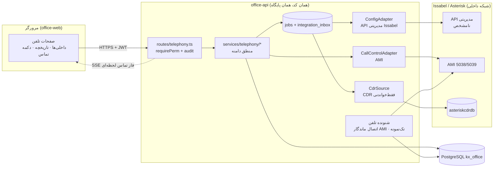

# معماری هدف ماژول تلفن (Issabel/Asterisk)

> وابسته به: `current-state-analysis.md`. هر جا به رفتار Issabel اشاره شده و در `open-questions.md` تأیید نشده، فرض طراحی است و قبل از پیاده‌سازی باید تأیید شود.

## ۱. اصول

1. **بدون زیرساخت موازی:** ماژول داخل `apps/office-api` ساخته می‌شود و از پایگاه `kx_office`، صف `jobs`، صندوق `integration_inbox`، `lib/crypto.ts`، `lib/audit.ts` و RBAC موجود استفاده می‌کند. سرویس، پایگاه یا Broker جدید اضافه نمی‌شود.
2. **مرورگر هرگز به مرکز تلفن وصل نمی‌شود.** AMI، ARI، API مدیریتی و پایگاه CDR فقط از سمت سرور office-api قابل دسترسی‌اند.
3. **سه رابط جدا با سه اعتبارنامه جدا:**
   - **رابط پیکربندی** (مدیریت داخلی‌ها): فقط روش رسمی نسخه نصب‌شده (مثلاً REST API مدیریتی Issabel در صورت وجود). بدون آن، فقط حالت «فقط‌خواندنی + ثبت دستی».
   - **رابط کنترل تماس** (AMI): Originate برای تماس با یک کلیک، رویدادهای تماس و وضعیت داخلی.
   - **منبع تاریخچه** (CDR): خواندن فقط‌خواندنی جدول CDR یا رویداد `Cdr` از AMI.
4. **سه وضعیت جدا:** وضعیت همگام‌سازی پیکربندی داخلی، وضعیت عملیاتی داخلی (Device State) و وضعیت تماس هرگز در یک فیلد ترکیب نمی‌شوند.
5. **قطع Issabel هسته را مختل نمی‌کند:** تمام فراخوانی‌های تلفن ناهمگام یا با Timeout کوتاه هستند؛ خطای تلفن فقط بخش تلفن را «در دسترس نیست» نشان می‌دهد. داده‌های کاربران، نامه‌ها و نگاشت داخلی‌ها در `kx_office` می‌مانند.
6. **منبع حقیقت:** برای پیکربندی داخلی، **Issabel** منبع حقیقت است و اتوماسیون «آینه + درخواست تغییر» دارد. برای تخصیص داخلی به کارمند و اتصال تماس به پرونده، **اتوماسیون** منبع حقیقت است.

## ۲. نمای کلی



## ۳. اجزا و مرز مسئولیت

| جزء | مسیر پیشنهادی | مسئولیت | نیست |
|---|---|---|---|
| مسیرها | `apps/office-api/src/routes/telephony.ts` | اعتبارسنجی zod، `requirePerm`، تراکنش و `audit`، پاسخ بدون اسرار | تماس مستقیم با PBX در مسیر درخواست (به‌جز Originate با Timeout کوتاه) |
| دامنه | `apps/office-api/src/services/telephony/` (`extensions.ts`، `calls.ts`، `links.ts`، `numbers.ts`) | قواعد تخصیص، Maker-Checker، نرمال‌سازی شماره، تطبیق تماس با کاربر و مخاطب | جزئیات پروتکل |
| آداپتورها | `apps/office-api/src/integration/telephony/` (`config-adapter.ts`، `ami.ts`، `cdr.ts`) | ترجمه پروتکل، Timeout، تبدیل خطا به `HttpError` با کدهای `pbx_*` | تصمیم کسب‌وکار |
| شنونده | `apps/office-api/src/integration/telephony/listener.ts` با پرچم `TELEPHONY_LISTENER_ENABLED` | اتصال ماندگار AMI، اتصال مجدد با Backoff، تجمیع رویدادها بر اساس `Linkedid`، به‌روزرسانی `calls` و `pbx_extensions.device_state` | پردازش کند یا تماس با سرویس بیرونی |
| کارهای صف | `registerHandler('telephony.*')` | اعمال تغییر داخلی، همگام‌سازی فهرست داخلی‌ها، برداشت CDR، تطبیق CDR با تماس زنده | — |
| زمان‌بند | افزودن به `services/scheduler.ts` | صف‌کردن همگام‌سازی داخلی‌ها و برداشت CDR در فاصله تنظیم‌شده | — |
| UI | `apps/office-web/src/pages/Telephony*.tsx`، مؤلفه `CallButton` | نمایش و درخواست؛ هیچ اطلاعات اتصال PBX | — |

### چرا شنونده جدا از Worker؟

AMI یک اتصال TCP ماندگار است و رویدادها را Push می‌کند. Worker فعلی (`services/jobs.ts`) و Scheduler بر پایه `setInterval` هستند و می‌توانند چند نمونه داشته باشند. شنونده باید **دقیقاً یک نمونه** باشد (مانند `SCHEDULER_ENABLED`) تا رویداد تکراری و اتصال‌های متعدد ایجاد نشود. همان تصویر Docker با متغیر محیطی، نه سرویس جدید. برای جلوگیری از دو شنونده هم‌زمان، قفل مشورتی `pg_try_advisory_lock(hashtext('telephony-listener'))` در شروع گرفته می‌شود.

## ۴. رابط‌های آداپتور (قرارداد)

```ts
interface PbxConfigAdapter {            // فقط اگر روش رسمی تأیید شود؛ وگرنه ReadOnlyConfigAdapter
  capabilities(): Promise<{ list: boolean; create: boolean; update: boolean; disable: boolean; remove: boolean; applyConfig: boolean }>;
  listExtensions(): Promise<PbxExtension[]>;
  getExtension(ext: string): Promise<PbxExtension | null>;
  createExtension(input: ExtensionSpec, idempotencyKey: string): Promise<ApplyResult>;
  updateExtension(ext: string, patch: Partial<ExtensionSpec>, idempotencyKey: string): Promise<ApplyResult>;
  disableExtension(ext: string, idempotencyKey: string): Promise<ApplyResult>;
  deleteExtension(ext: string, idempotencyKey: string): Promise<ApplyResult>;
}

interface CallControlAdapter {          // AMI
  originate(req: { fromExtension: string; to: string; callerName?: string; actionId: string; vars: Record<string, string> }): Promise<{ accepted: boolean }>;
  extensionState(ext: string): Promise<DeviceState>;
  ping(): Promise<number>;              // میلی‌ثانیه
}

interface CdrSource {
  fetchSince(cursor: CdrCursor, limit: number): Promise<{ rows: CdrRow[]; next: CdrCursor }>;
}
```

- `ReadOnlyConfigAdapter`: اگر API مدیریتی وجود نداشته باشد، فهرست داخلی‌ها از رویدادهای/دستورات فقط‌خواندنی AMI (مانند `PJSIPShowEndpoints` یا `SIPpeers` بسته به درایور) یا ورود دستی/فایل CSV ساخته می‌شود و `create/update/disable/remove` غیرفعال‌اند. UI در این حالت «درخواست تغییر» را به‌صورت تیکت برای مدیر مرکز تلفن ثبت می‌کند و پس از اعمال دستی، همگام‌سازی آن را تأیید می‌کند.
- `FakePbx`: پیاده‌سازی درون‌حافظه برای آزمون‌ها (مثل `outbox` در `notifications.ts`). در CI هیچ اتصال واقعی نیست.

## ۵. جریان داده‌ها

| جریان | سازوکار | حذف تکرار |
|---|---|---|
| فهرست داخلی‌ها از PBX | کار `telephony.sync_extensions` (دوره‌ای و دستی) → مقایسه با `pbx_extensions` → `sync_status` | کلید `(connection_id, extension)` |
| تغییر داخلی | درخواست → تأیید → کار `telephony.apply_change` → آداپتور → بازخوانی و تأیید | `idempotency_key` درخواست؛ قبل از اعمال، وضعیت فعلی در PBX خوانده می‌شود |
| رویداد زنده تماس | شنونده AMI → به‌روزرسانی `calls` و `call_events` در حافظه تجمیع و هر رویداد معنادار یک UPSERT | `calls.pbx_linkedid` یکتا؛ `call_events (call_id, pbx_uniqueid, event_type, seq)` یکتا |
| تاریخچه نهایی | کار `telephony.pull_cdr` با مکان‌نما در `integrations.state` (الگوی `pollEvents`) | کلید `(connection_id, cdr_uniqueid, cdr_sequence)` |
| تماس با یک کلیک | API → اعتبارسنجی → `click_to_call_requests` → Originate با `ActionID` | `idempotency_key` از سمت مرورگر؛ جلوگیری از دوبار کلیک |

`integration_inbox` فقط برای رویدادهای کم‌حجم و مهم استفاده می‌شود (مثلاً نتیجه اعمال تغییر یا رویدادهای Webhook احتمالی). رویدادهای خام AMI پرحجم‌اند و مستقیم در جداول عملیاتی تلفن تجمیع می‌شوند تا صندوق و ممیزی شلوغ نشوند.

## ۶. تحمل خطا

- مدار قطع (Circuit Breaker) ساده برای هر اتصال: پس از N خطای پیاپی، حالت `degraded` در `telephony_connections.health` و توقف تلاش تا زمان بازبینی؛ UI بنر «مرکز تلفن در دسترس نیست».
- شنونده AMI: اتصال مجدد با Backoff نمایی تا ۶۰ ثانیه؛ پس از اتصال مجدد، تماس‌های «زنده» که رویداد پایان نگرفته‌اند با CDR تطبیق داده می‌شوند (`call-lifecycle.md`).
- Timeoutها: Originate ۵ ثانیه، API مدیریتی ۱۵ ثانیه، پرس‌وجوی CDR ۳۰ ثانیه.
- هیچ مسیر هسته (نامه، کارتابل، ورود) به ماژول تلفن وابسته نیست؛ دکمه تماس در صورت خطا غیرفعال می‌شود.

## ۷. استقرار

- همان کانتینر `office-api`. نمونه‌ای که `TELEPHONY_LISTENER_ENABLED=true` دارد باید از شبکه کانتینر به IP مرکز تلفن مسیر داشته باشد.
- ارتباط AMI ترجیحاً روی TLS (پورت ۵۰۳۹) یا تونل/VLAN مدیریتی؛ `permit/deny` در `manager.conf` فقط برای IP سرور اتوماسیون (تنظیم سمت PBX توسط مدیر مرکز تلفن).
- هیچ پورت جدیدی از office-api به بیرون باز نمی‌شود، مگر Webhook احتمالی که فعلاً لازم نیست.

## ۸. تصمیم‌های معماری و جایگزین‌های ردشده

| تصمیم | گزینه ردشده | دلیل |
|---|---|---|
| ماژول داخل office-api | میکروسرویس تلفن جدا | پشته و پایگاه واحد، استقرار ساده، استفاده از RBAC و ممیزی موجود؛ مرز آداپتور امکان جداسازی بعدی را حفظ می‌کند |
| AMI برای کنترل تماس | ARI | ARI برای کنترل کامل تماس در اپلیکیشن Stasis است و dialplan را دور می‌زند؛ برای Originate و رویداد لازم نیست و ریسک اختلال در مسیریابی فعلی را دارد |
| API مدیریتی رسمی برای داخلی‌ها | نوشتن مستقیم در MySQL Issabel یا فایل‌های `*.conf` | دور زدن اعتبارسنجی Issabel، بازنویسی با Apply Config، شکستن ارتقای نسخه؛ طبق اصل ۴ مأموریت ممنوع است مگر با مستند و تأیید |
| CDR فقط‌خواندنی | فقط رویدادهای AMI | AMI در قطعی شبکه رویداد را از دست می‌دهد؛ CDR منبع نهایی و قابل بازسازی است |
| SSE برای لحظه‌ای | WebSocket | یک‌طرفه کافی است، با Express و JWT ساده‌تر است و کتابخانه جدید نمی‌خواهد |
