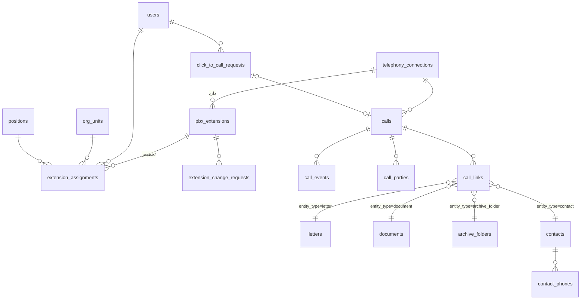

# مدل داده پیشنهادی ماژول تلفن

> این سند **پیشنهاد** است و هیچ مهاجرتی ایجاد نشده است. پیاده‌سازی در فایل‌های بعدی `apps/office-api/src/db/migrations/005_telephony_*.sql` و به سبک مهاجرت‌های موجود (SQL ساده، یک تراکنش) خواهد بود. نام‌ها و سبک ستون‌ها با `001_init.sql` یکدست است (uuid با `gen_random_uuid()`، `timestamptz`، CHECK برای enumها، توضیح فارسی/انگلیسی کوتاه).

## ۱. نمودار روابط



## ۲. تغییر در جداول موجود

```sql
-- integrations: یک ردیف وضعیت کلی ماژول (برای صفحه یکپارچه‌سازی موجود)
ALTER TABLE integrations DROP CONSTRAINT integrations_kind_check;
ALTER TABLE integrations ADD CONSTRAINT integrations_kind_check
  CHECK (kind IN ('meetings','accounting','crm','government','intake','ai','telephony'));
-- state: مکان‌نمای CDR (الگوی pollEvents) ؛ settings: محدوده داخلی‌ها، فواصل همگام‌سازی، پیش‌شماره‌ها
```

هیچ ستونی به `users` اضافه نمی‌شود؛ داخلی فقط از طریق `extension_assignments` به کاربر وصل است.

## ۳. جداول جدید

### ۳.۱ اتصال‌ها و اسرار

```sql
CREATE TABLE telephony_connections (
  id             uuid PRIMARY KEY DEFAULT gen_random_uuid(),
  name           text NOT NULL,                                  -- مثلاً «مرکز تلفن ساختمان مرکزی»
  purpose        text NOT NULL CHECK (purpose IN ('config_api','ami','cdr_db')),
  pbx_key        text NOT NULL DEFAULT 'main',                   -- گروه‌بندی اتصال‌های یک PBX (پشتیبانی آینده از چند PBX)
  host           text NOT NULL,
  port           int  NOT NULL CHECK (port BETWEEN 1 AND 65535),
  use_tls        boolean NOT NULL DEFAULT true,
  tls_fingerprint text,                                          -- Pin گواهی خودامضا (SHA-256)
  username       text,
  secret_enc     text,                                           -- encryptText() ؛ هرگز در API برگردانده نمی‌شود
  settings       jsonb NOT NULL DEFAULT '{}'::jsonb,             -- نسخه API، نام پایگاه CDR، context تماس، ...
  is_active      boolean NOT NULL DEFAULT false,
  health         text NOT NULL DEFAULT 'unknown' CHECK (health IN ('unknown','ok','degraded','down')),
  last_ok_at     timestamptz,
  last_error     text,
  updated_by     uuid REFERENCES users(id),
  updated_at     timestamptz NOT NULL DEFAULT now(),
  UNIQUE (pbx_key, purpose)
);
```

### ۳.۲ آینه داخلی‌ها

```sql
CREATE TABLE pbx_extensions (
  id                 uuid PRIMARY KEY DEFAULT gen_random_uuid(),
  pbx_key            text NOT NULL DEFAULT 'main',
  extension          text NOT NULL CHECK (extension ~ '^[0-9]{2,8}$'),
  display_name       text,
  tech               text,                                       -- 'pjsip' | 'sip' | 'iax2' | ... (از PBX)
  lifecycle          text NOT NULL DEFAULT 'active' CHECK (lifecycle IN ('active','disabled','deleted')),
  sync_status        text NOT NULL DEFAULT 'in_sync'
                     CHECK (sync_status IN ('in_sync','pending_change','drift','missing_on_pbx','error')),
  device_state       text NOT NULL DEFAULT 'unknown'
                     CHECK (device_state IN ('unknown','not_in_use','in_use','busy','ringing','on_hold','unavailable','invalid')),
  device_state_at    timestamptz,
  pbx_snapshot       jsonb NOT NULL DEFAULT '{}'::jsonb,          -- فیلدهای غیرحساس آخرین وضعیت دیده‌شده (بدون Secret)
  pbx_snapshot_hash  text,
  last_seen_on_pbx_at timestamptz,
  last_synced_at     timestamptz,
  last_error         text,
  created_at         timestamptz NOT NULL DEFAULT now(),
  updated_at         timestamptz NOT NULL DEFAULT now(),
  UNIQUE (pbx_key, extension)
);
CREATE INDEX pbx_extensions_sync_idx ON pbx_extensions (sync_status) WHERE sync_status <> 'in_sync';
```

### ۳.۳ تخصیص

```sql
CREATE EXTENSION IF NOT EXISTS btree_gist;                     -- اگر مجاز نبود: قفل ردیف در سرویس

CREATE TABLE extension_assignments (
  id            uuid PRIMARY KEY DEFAULT gen_random_uuid(),
  extension_id  uuid NOT NULL REFERENCES pbx_extensions(id),
  user_id       uuid REFERENCES users(id),
  unit_id       uuid NOT NULL REFERENCES org_units(id),
  position_id   uuid REFERENCES positions(id),
  is_primary    boolean NOT NULL DEFAULT true,
  valid_from    timestamptz NOT NULL DEFAULT now(),
  valid_to      timestamptz,
  note          text,
  assigned_by   uuid NOT NULL REFERENCES users(id),
  ended_by      uuid REFERENCES users(id),
  end_reason    text,
  created_at    timestamptz NOT NULL DEFAULT now(),
  CHECK (valid_to IS NULL OR valid_to > valid_from),
  EXCLUDE USING gist (extension_id WITH =, tstzrange(valid_from, valid_to) WITH &&)
);
CREATE UNIQUE INDEX ext_assign_one_active ON extension_assignments (extension_id) WHERE valid_to IS NULL;
CREATE UNIQUE INDEX ext_assign_one_primary_per_user ON extension_assignments (user_id) WHERE valid_to IS NULL AND is_primary AND user_id IS NOT NULL;
CREATE INDEX ext_assign_user_idx ON extension_assignments (user_id) WHERE valid_to IS NULL;
CREATE INDEX ext_assign_unit_idx ON extension_assignments (unit_id) WHERE valid_to IS NULL;
```

سازگاری `position_id` با `unit_id` در سرویس بررسی می‌شود (قید بین‌جدولی در PostgreSQL بدون تریگر ممکن نیست).

### ۳.۴ درخواست تغییر داخلی

```sql
CREATE TABLE extension_change_requests (
  id                 uuid PRIMARY KEY DEFAULT gen_random_uuid(),
  extension_id       uuid REFERENCES pbx_extensions(id),         -- null برای ایجاد تا پیش از اعمال
  pbx_key            text NOT NULL DEFAULT 'main',
  extension          text NOT NULL,
  op                 text NOT NULL CHECK (op IN ('create','update','disable','enable','delete')),
  origin             text NOT NULL DEFAULT 'user' CHECK (origin IN ('user','pbx_drift')),
  payload            jsonb NOT NULL DEFAULT '{}'::jsonb,         -- بدون Secret
  base_snapshot_hash text,                                       -- برای تشخیص تعارض هنگام اعمال
  sensitive          boolean NOT NULL DEFAULT true,
  status             text NOT NULL DEFAULT 'draft' CHECK (status IN
                     ('draft','pending_approval','approved','rejected','applying','applied','failed','manual_pending','cancelled','observed')),
  reason             text,
  idempotency_key    uuid NOT NULL DEFAULT gen_random_uuid() UNIQUE,
  requested_by       uuid REFERENCES users(id),
  requested_at       timestamptz NOT NULL DEFAULT now(),
  decided_by         uuid REFERENCES users(id),
  decided_at         timestamptz,
  decision_note      text,
  applied_at         timestamptz,
  attempts           int NOT NULL DEFAULT 0,
  result             jsonb,                                      -- پاسخ خلاصه PBX (بدون Secret)
  error_code         text,
  error              text,
  CHECK (decided_by IS NULL OR requested_by IS NULL OR decided_by <> requested_by)
);
CREATE INDEX ext_change_open_idx ON extension_change_requests (status) WHERE status IN ('pending_approval','approved','applying','manual_pending');
-- فقط یک درخواست باز برای هر داخلی
CREATE UNIQUE INDEX ext_change_one_open ON extension_change_requests (pbx_key, extension)
  WHERE status IN ('draft','pending_approval','approved','applying','manual_pending');
```

### ۳.۵ تماس‌ها

```sql
CREATE TABLE calls (
  id               uuid PRIMARY KEY DEFAULT gen_random_uuid(),
  pbx_key          text NOT NULL DEFAULT 'main',
  pbx_linkedid     text NOT NULL,                                -- شناسه یکتای تماس منطقی در Asterisk
  direction        text NOT NULL CHECK (direction IN ('inbound','outbound','internal','unknown')),
  state            text NOT NULL DEFAULT 'ringing'
                   CHECK (state IN ('originating','ringing','answered','on_hold','ended')),
  disposition      text CHECK (disposition IN ('answered','no_answer','busy','failed','cancelled','congestion')),
  external_number  text,                                         -- نرمال E.164، مثلاً +982188...
  external_number_raw text,
  extension_id     uuid REFERENCES pbx_extensions(id),           -- داخلی اصلی سمت سازمان (پاسخ‌دهنده/شروع‌کننده)
  user_id          uuid REFERENCES users(id),                    -- Snapshot از تخصیص در لحظه تماس
  unit_id          uuid REFERENCES org_units(id),                -- Snapshot
  queue_name       text,
  started_at       timestamptz NOT NULL,
  answered_at      timestamptz,
  ended_at         timestamptz,
  ring_seconds     int,
  talk_seconds     int,                                          -- billsec
  source           text NOT NULL DEFAULT 'ami' CHECK (source IN ('ami','cdr','click_to_call')),
  cdr_reconciled   boolean NOT NULL DEFAULT false,
  note             text,                                         -- یادداشت کاربر
  outcome          text,                                         -- نتیجه کاری انتخابی (مثلاً «پیگیری لازم»)
  confidentiality  int NOT NULL DEFAULT 0 CHECK (confidentiality BETWEEN 0 AND 2),
  created_at       timestamptz NOT NULL DEFAULT now(),
  updated_at       timestamptz NOT NULL DEFAULT now(),
  UNIQUE (pbx_key, pbx_linkedid)
);
CREATE INDEX calls_user_time_idx ON calls (user_id, started_at DESC);
CREATE INDEX calls_unit_time_idx ON calls (unit_id, started_at DESC);
CREATE INDEX calls_ext_time_idx ON calls (extension_id, started_at DESC);
CREATE INDEX calls_number_idx ON calls (external_number, started_at DESC);
CREATE INDEX calls_live_idx ON calls (state) WHERE state <> 'ended';
CREATE INDEX calls_time_brin ON calls USING brin (started_at);

-- طرف‌های داخلی دیگر (انتقال، صف، زنگ گروهی)
CREATE TABLE call_parties (
  call_id       uuid NOT NULL REFERENCES calls(id) ON DELETE CASCADE,
  extension_id  uuid NOT NULL REFERENCES pbx_extensions(id),
  user_id       uuid REFERENCES users(id),
  role          text NOT NULL CHECK (role IN ('caller','callee','ringing','transfer_target','queue_member')),
  answered      boolean NOT NULL DEFAULT false,
  joined_at     timestamptz,
  left_at       timestamptz,
  PRIMARY KEY (call_id, extension_id, role)
);
CREATE INDEX call_parties_user_idx ON call_parties (user_id);

-- رویدادهای خام خلاصه‌شده (برای عیب‌یابی و بازسازی؛ با سیاست نگهداری کوتاه)
CREATE TABLE call_events (
  id            bigserial PRIMARY KEY,
  call_id       uuid NOT NULL REFERENCES calls(id) ON DELETE CASCADE,
  pbx_uniqueid  text NOT NULL,
  event_type    text NOT NULL,                                   -- Newchannel, DialBegin, BridgeEnter, Hangup, Cdr, ...
  seq           int  NOT NULL,                                   -- ترتیب دریافت در شنونده برای این uniqueid
  occurred_at   timestamptz NOT NULL,
  data          jsonb NOT NULL DEFAULT '{}'::jsonb,              -- فیلدهای مجاز (Allowlist)، نه کل رویداد
  UNIQUE (pbx_uniqueid, event_type, seq)
);
CREATE INDEX call_events_call_idx ON call_events (call_id, occurred_at);

-- ردیف‌های CDR دریافتی، برای حذف تکرار و تطبیق
CREATE TABLE cdr_records (
  pbx_key       text NOT NULL DEFAULT 'main',
  cdr_uniqueid  text NOT NULL,
  cdr_sequence  bigint NOT NULL DEFAULT 0,
  linkedid      text,
  call_id       uuid REFERENCES calls(id) ON DELETE SET NULL,
  calldate      timestamptz NOT NULL,
  data          jsonb NOT NULL,                                  -- src, dst, dcontext, channel, dstchannel, disposition, duration, billsec
  received_at   timestamptz NOT NULL DEFAULT now(),
  PRIMARY KEY (pbx_key, cdr_uniqueid, cdr_sequence)
);
CREATE INDEX cdr_records_linkedid_idx ON cdr_records (linkedid);
```

**حجم:** اگر تعداد تماس روزانه زیاد باشد (پاسخ در `open-questions.md`)، `calls` و `call_events` بر اساس `started_at` ماهانه پارتیشن می‌شوند. تا آن زمان BRIN روی زمان کافی است.

### ۳.۶ اتصال تماس به پرونده

```sql
CREATE TABLE call_links (
  id            uuid PRIMARY KEY DEFAULT gen_random_uuid(),
  call_id       uuid NOT NULL REFERENCES calls(id) ON DELETE CASCADE,
  entity_type   text NOT NULL CHECK (entity_type IN ('letter','document','archive_folder','contact','meeting','resolution')),
  entity_id     text NOT NULL,                                   -- uuid محلی یا external_id برای meeting/resolution
  linked_by     uuid REFERENCES users(id),                       -- null = تطبیق خودکار
  match_method  text NOT NULL DEFAULT 'manual' CHECK (match_method IN ('manual','auto_number','click_to_call')),
  note          text,
  created_at    timestamptz NOT NULL DEFAULT now(),
  UNIQUE (call_id, entity_type, entity_id)
);
CREATE INDEX call_links_entity_idx ON call_links (entity_type, entity_id);
```

قید ارجاعی چندریختی در پایگاه ممکن نیست؛ سرویس هنگام درج، وجود و **قابل دیدن بودن** موجودیت برای کاربر را با `loadVisibleLetter` و `documentVisibleSql` بررسی می‌کند. با حذف موجودیت مقصد، کار شبانه پیوندهای یتیم را پاک می‌کند.

### ۳.۷ مخاطبان (پیشنهادی، منوط به تصمیم)

```sql
CREATE TABLE contacts (
  id            uuid PRIMARY KEY DEFAULT gen_random_uuid(),
  kind          text NOT NULL DEFAULT 'person' CHECK (kind IN ('person','organization')),
  full_name     text NOT NULL,
  organization  text,
  title         text,
  owner_unit_id uuid REFERENCES org_units(id),                  -- null = عمومی
  confidentiality int NOT NULL DEFAULT 0 CHECK (confidentiality BETWEEN 0 AND 2),
  notes         text,
  is_active     boolean NOT NULL DEFAULT true,
  created_by    uuid REFERENCES users(id),
  created_at    timestamptz NOT NULL DEFAULT now(),
  updated_at    timestamptz NOT NULL DEFAULT now()
);
CREATE TABLE contact_phones (
  id            uuid PRIMARY KEY DEFAULT gen_random_uuid(),
  contact_id    uuid NOT NULL REFERENCES contacts(id) ON DELETE CASCADE,
  number        text NOT NULL CHECK (number ~ '^\+[1-9][0-9]{6,14}$'),   -- E.164
  label         text,                                                    -- همراه، دفتر، فکس
  is_primary    boolean NOT NULL DEFAULT false,
  UNIQUE (contact_id, number)
);
CREATE INDEX contact_phones_number_idx ON contact_phones (number);
-- اختیاری: ستون letters.contact_id برای پیوند طرف نامه به مخاطب (فاز بعد)
```

### ۳.۸ تماس با یک کلیک

```sql
CREATE TABLE click_to_call_requests (
  id               uuid PRIMARY KEY DEFAULT gen_random_uuid(),
  user_id          uuid NOT NULL REFERENCES users(id),
  extension_id     uuid NOT NULL REFERENCES pbx_extensions(id),
  target_number    text NOT NULL,                                -- نرمال‌شده
  context_type     text,                                         -- letter | contact | user | document
  context_id       text,
  idempotency_key  uuid NOT NULL,
  ami_action_id    text NOT NULL UNIQUE,
  status           text NOT NULL DEFAULT 'requested'
                   CHECK (status IN ('requested','sent','ringing_agent','connected','failed','rejected')),
  call_id          uuid REFERENCES calls(id),
  error_code       text,
  created_at       timestamptz NOT NULL DEFAULT now(),
  updated_at       timestamptz NOT NULL DEFAULT now(),
  UNIQUE (user_id, idempotency_key)
);
CREATE INDEX c2c_user_time_idx ON click_to_call_requests (user_id, created_at DESC);
```

### ۳.۹ اجرای همگام‌سازی

```sql
CREATE TABLE telephony_sync_runs (
  id           bigserial PRIMARY KEY,
  kind         text NOT NULL CHECK (kind IN ('extensions','cdr','reconcile')),
  started_at   timestamptz NOT NULL DEFAULT now(),
  finished_at  timestamptz,
  status       text NOT NULL DEFAULT 'running' CHECK (status IN ('running','ok','partial','failed')),
  stats        jsonb NOT NULL DEFAULT '{}'::jsonb,               -- seen, created, drift, missing, inserted, duplicates
  error        text
);
CREATE INDEX telephony_sync_runs_kind_idx ON telephony_sync_runs (kind, started_at DESC);
```

## ۴. مجوزهای جدید

افزوده به `PERMISSIONS` در `services/permissions.ts` با ماژول «تلفن»، و یک `INSERT ... role_permissions` در مهاجرت برای نقش‌های موجود (الگوی `002` و `003`). فهرست کامل در `security-and-audit.md`.

## ۵. رویدادهای اعلان جدید

`telephony.change_pending`، `telephony.change_applied`، `telephony.change_failed`، `telephony.missed_call` (اختیاری)، `telephony.connection_down` به `NOTIFICATION_EVENTS` و `DEFAULT_TEMPLATES` اضافه می‌شوند.

## ۶. نگهداری داده

| داده | پیش‌فرض پیشنهادی | تنظیم |
|---|---|---|
| `call_events` | ۹۰ روز | `integrations.settings.retention.callEventsDays` |
| `cdr_records.data` | ۱۸ ماه | قابل تنظیم |
| `calls` | مطابق سیاست سازمان (`open-questions.md`) | ستون‌های حساس پس از دوره، ناشناس‌سازی (`external_number` → هش) |
| `click_to_call_requests` | ۱۲ ماه | — |
