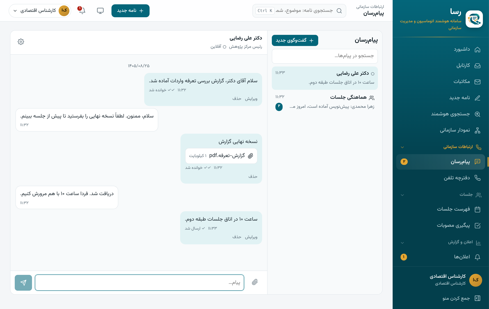
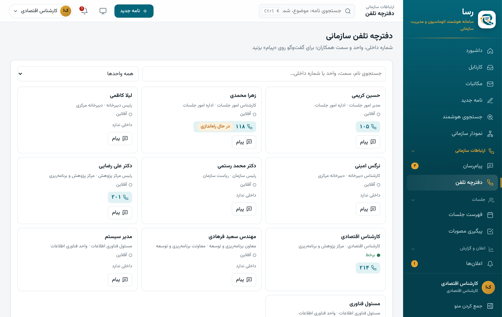
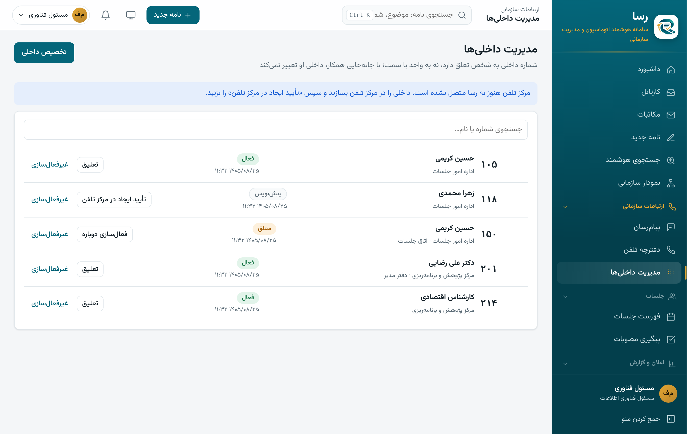
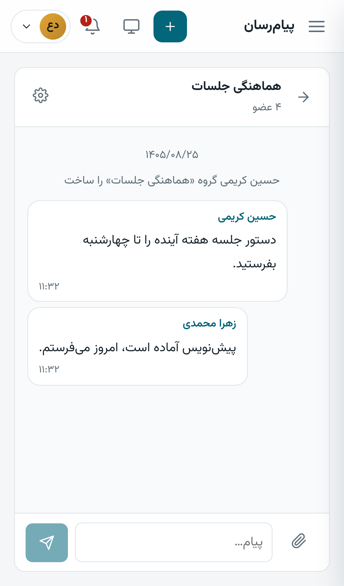

# ماژول ارتباطات سازمانی رسا — گزارش فاز صفر و وضعیت پیاده‌سازی

> مبنا: سند «Rasa Communications Module Implementation Spec» نسخه ۱.۰ (۱۴۰۵/۰۸/۲۵) و کد شاخه `claude/commission-platform` (کامیت `31ad29e`).
> نام جدول‌ها و کلیدها از کد و migrationها استخراج شده، نه حدس.

## ۱. نقشه اجزای مرتبط

| جزء | محل در کد | استفاده در ماژول ارتباطات |
|---|---|---|
| API | `apps/office-api` (Node 22، Express 5، TypeScript، zod، pino) | ماژول جدید: `src/routes/communications.ts`، `src/services/communications.ts` |
| وب | `apps/office-web` (React 19، Vite، راست‌به‌چپ) | صفحه‌های `pages/CommMessenger.tsx`، `CommDirectory.tsx`، `CommExtensions.tsx` و `communications.css` |
| پایگاه داده | PostgreSQL 16، پایگاه `kx_office`، migrationهای SQL شماره‌دار در `src/db/migrations` | `008_communications.sql` |
| ذخیره فایل | `lib/storage.ts` (هر فایل جدا با AES-256-GCM)، `lib/files.ts` (فهرست مجاز پسوند + بررسی بایت‌های آغازین، قلاب اسکن بدافزار) | پیوست پیام‌ها با پیشوند `messages/` |
| اعلان | `services/notifications.ts` (درون‌برنامه، ایمیل و پیامک از صف) | رویداد جدید `message.received` |
| صف کار | `services/jobs.ts` (`jobs` با `FOR UPDATE SKIP LOCKED` و تلاش مجدد نمایی) | کار `communications.provision` |
| ممیزی | `lib/audit.ts` (زنجیره هش، قفل مشورتی سراسری، تریگر ضد UPDATE/DELETE) | فقط عملیات مدیریتی؛ نه تک‌تک پیام‌ها |
| بلادرنگ | پیش از این ماژول: رسا فقط polling ۶۰ ثانیه‌ای داشت. سامانه جلسات (`apps/api/src/realtime.ts`) Socket.IO 4.8 دارد | Socket.IO با همان الگو در `services/realtime.ts` |

## ۲. موجودیت‌های سازمانی (کلیدهای واقعی)

| جدول | کلید | نکته |
|---|---|---|
| `users` | `id uuid` | `is_active` برای غیرفعال‌سازی؛ کاربر حذف نمی‌شود. حساب داخلی `username = 'system'` از فهرست‌ها کنار گذاشته می‌شود. |
| `org_units` | `id uuid`، `parent_id` | درختی |
| `positions` | `id uuid`، `unit_id` → `org_units`، `is_manager` | |
| `user_positions` | `(user_id, position_id)`، `is_primary`، `start_date`، `end_date` | یک شخص می‌تواند چند سمت داشته باشد؛ سمت جاری = `end_date IS NULL OR end_date >= current_date`، سمت اصلی اول |
| `roles`، `role_permissions`، `user_roles(scope_unit_id)` | | RBAC با محدوده واحد |

**جدول موازی برای کارکنان یا واحدها ساخته نشد.** همه جدول‌های جدید به `users(id)` با `ON DELETE RESTRICT` اشاره می‌کنند تا سابقه تماس و پیام به‌صورت آبشاری پاک نشود.

**سیاست کارکنان چندسمتی:** شماره داخلی به شخص (`user_id`) تعلق دارد، نه به سمت. در دفترچه تلفن سمت اصلی جاری نشان داده می‌شود.

## ۳. احراز هویت و مجوز

- JWT کوتاه‌عمر (`ACCESS_TOKEN_TTL`، پیش‌فرض ۱۵ دقیقه) + توکن تمدید چرخشی؛ `authenticate` در `auth/middleware.ts`.
- `AuthUser.can(permission, unitId?)` و `requirePerm`.
- **نکته مهم:** `ensureBaseData` مجوزهای پیش‌فرض را فقط به نقشی می‌دهد که تازه ساخته شود (به‌جز `admin` که همیشه همه مجوزها را دارد). پس مجوز جدید روی سرورهای موجود به نقش‌های دیگر نمی‌رسد مگر از صفحه «نقش‌ها و مجوزها».

مجوزهای افزوده‌شده:

| مجوز | کاربرد | نقش پیش‌فرض (نصب جدید) |
|---|---|---|
| `communications.extension.manage` | تخصیص و مدیریت داخلی‌ها | مدیر سیستم، فناوری اطلاعات |
| `communications.conversation.manage` | ایجاد و مدیریت گروه‌های سازمانی | مدیر سیستم، مدیر واحد |

پیام‌رسان (گفت‌وگوی دونفره) و دفترچه تلفن برای همه کاربران فعال باز است، مثل نمودار سازمانی. سند `communications.view`، `communications.message.use` و `communications.directory.view` را پیشنهاد کرده بود؛ به دلیل نکته بالا آن‌ها اضافه نشدند (بند ۶).

## ۴. الگوی Migration و API

- Migration: فایل SQL شماره‌دار، هر کدام در یک تراکنش، ثبت در `schema_migrations`، اجرای خودکار هنگام شروع API.
- API: مسیرهای Express زیر `/api/...` (نه `/api/v1`)، اعتبارسنجی zod با `body()`، خطا با قالب `{ error: { code, message, details } }`، شیء نادیدنی = ۴۰۴.
- ساختار پوشه سند (`modules/communications/controllers|services|…`) با قرارداد مخزن جور نیست (مسیرها در `routes/`، منطق در `services/`). همان قرارداد مخزن رعایت شد.

## ۵. استقرار و پورت‌ها

- Docker Compose: `office-web` (nginx، ۸۱۰۰ و با TLS ۸۴۴۳)، `office-api` (۴۱۰۰ داخلی)، `office-db`. نصب بدون Docker: systemd و API خودش فایل‌های وب را سرو می‌کند.
- کانال بلادرنگ: مسیر `/api/realtime/` (Socket.IO). در nginx یک `location` جدا با Upgrade اضافه شد. CSP فعلی (`connect-src 'self'`) اتصال WebSocket هم‌دامنه را می‌پذیرد.
- **هیچ پورت، کانتینر یا تنظیمی برای مرکز تلفن در این مرحله اضافه نشده است.**

## ۶. اختلاف‌های سند با پروژه و تصمیم گرفته‌شده

| # | سند | واقعیت پروژه | تصمیم |
|---|---|---|---|
| ۱ | Asterisk روی همان سرور | Issabel در سازمان نصب نیست؛ رسا به سرور جدید منتقل می‌شود | Asterisk در کانتینر جدا کنار رسا روی سرور جدید (فاز بعد). طرح Issabel (PR #7) بسته شد. |
| ۲ | خط FTTH: ثبت مستقیم یا FXO | سازمان Gateway FXO دارد | گزینه B سند: مودم ← FXO ← Asterisk. مدل گیت‌وی هنوز لازم است. |
| ۳ | `communication_audit_logs` | ممیزی زنجیره‌ای رسا موجود است | از همان `audit_logs` برای عملیات مدیریتی استفاده شد؛ رویدادهای پرحجم (پیام، و بعداً رویداد تماس) در جدول عملیاتی خودشان. |
| ۴ | `/api/v1/communications/...` | قرارداد `/api/...` | `/api/communications/...` |
| ۵ | مجوز برای مشاهده بخش و پیام‌رسان | نقش‌های موجود مجوز جدید را نمی‌گیرند | پیام‌رسان و دفترچه برای همه باز؛ فقط مدیریت داخلی و گروه مجوز دارد |
| ۶ | WebSocket یا Socket.IO | Socket.IO در سامانه جلسات | Socket.IO 4.8 (همان نسخه lockfile) |
| ۷ | `communication_presence` (جدول) | یک نمونه API | وضعیت برخط از اتصال‌های زنده در حافظه؛ وضعیت تلفنی پس از اتصال Asterisk اضافه می‌شود |
| ۸ | `communication_devices`، `groups`، `queues`، `calls`، `call_events`، `recordings`، `settings` | بدون مرکز تلفن داده‌ای ندارند | به فاز تلفن موکول شد تا جدول خالی و بلااستفاده ساخته نشود |

## ۷. آنچه در این مرحله ساخته شد

**داده (`008_communications.sql`)**: `communication_extensions` (چرخه عمر `draft → provisioning → active ⇄ suspended → disabled` و `failed`؛ شماره زنده یکتا، شماره غیرفعال‌شده قابل تخصیص دوباره، حذف فیزیکی ندارد)، `communication_conversations` (دونفره یکتا با `direct_key`، گروه)، `communication_conversation_members` (`left_at` به‌جای حذف)، `communication_messages` (`client_id` برای جلوگیری از پیام تکراری، حذف نرم)، `communication_attachments`.

**API** (`/api/communications`): `status`، `directory`، `extensions` (فهرست، ایجاد، تغییر وضعیت، `provision`، `mine`)، `conversations` (فهرست، ایجاد، جزئیات، ویرایش، اعضا)، `messages` (فهرست با صفحه‌بندی زمانی، ارسال، پیوست، ویرایش، حذف، خوانده‌شدن، جستجو)، `attachments/:id`.

**رویدادهای بلادرنگ**: `NewMessage`، `MessageUpdated`، `MessageRead`، `ConversationUpdated`، `ConversationRemoved`، `UserPresenceChanged`. هر سوکت فقط به اتاق `user:<id>` خودش می‌پیوندد؛ رویداد فقط به اعضای گفت‌وگو می‌رود. سوکت هنگام انقضای توکن دسترسی و با غیرفعال‌شدن کاربر یا تغییر رمز بسته می‌شود.

**Adapter مرکز تلفن** (`services/pbx.ts`): تنها نقطه اتصال آینده به AMI؛ فعلاً درایور `none`. درخواست provision بدون مرکز تلفن پاسخ ۴۰۹ `pbx_not_configured` می‌دهد و مدیر داخلی را پس از ساخت در مرکز تلفن «تأیید دستی» می‌کند. وقتی درایور واقعی نصب شود، provision یک کار صف با تلاش مجدد و idempotent است.

**امنیت و حریم خصوصی**
- هیچ مسیری برای خواندن گفت‌وگوی دیگران، حتی برای مدیر سیستم، وجود ندارد؛ غیرعضو ۴۰۴ می‌گیرد.
- پیوست‌ها رمزنگاری‌شده ذخیره و فقط از API به اعضا داده می‌شوند (`no-store`). نوع فایل با فهرست مجاز و بایت آغازین بررسی می‌شود. سقف حجم `COMM_MAX_ATTACHMENT_MB` (پیش‌فرض ۲۰).
- اعلان پیام جدید متن پیام را ندارد؛ فقط فرستنده و نام گروه. به کاربر برخط اعلان داده نمی‌شود و برای هر گفت‌وگو فقط یک اعلان خوانده‌نشده می‌ماند.
- دفترچه تلفن ایمیل، موبایل و کد ملی را نشان نمی‌دهد.
- محدودیت نرخ: ارسال پیام ۶۰ در دقیقه، جستجو ۳۰ در دقیقه برای هر کاربر.
- ممیزی: تخصیص و تغییر داخلی، درخواست و نتیجه provision، ساخت و ویرایش گروه، افزودن، حذف و خروج عضو.
- پیام‌رسان برای مکاتبات طبقه‌بندی‌شده نیست؛ سطح طبقه‌بندی روی پیام اعمال نمی‌شود (بند ۸).

**آزمون**: `apps/office-api/test/communications.test.ts`، ۱۴ آزمون شامل دسترسی غیرمجاز به گفت‌وگو، پیام و فایل، idempotency ارسال و provision، چرخه عمر داخلی، تحویل بلادرنگ فقط به اعضا و قطع سوکت پس از غیرفعال‌سازی کاربر.

## ۸. تصمیم‌های باز (پیش از فازهای مربوط)

1. مدل و تعداد پورت Gateway FXO (برای فاز خط شهری).
2. تماس خروجی شهری برای همه کاربران مجاز است یا بر اساس نقش و واحد؟
3. ضبط مکالمات لازم است؟ مدت نگهداری و اطلاع‌رسانی؟
4. پیام‌رسان گروه عمومی کل سازمان هم داشته باشد یا فقط گروه‌های تعریف‌شده؟
5. آیا ارسال محتوای طبقه‌بندی‌شده در پیام‌رسان باید ممنوع یا برچسب‌دار شود؟
6. مدت نگهداری پیام‌ها و فایل‌ها.
7. مرورگرهای هدف WebRTC، تعداد داخلی‌ها و تماس هم‌زمان.

## ۹. فاز بعد (تلفن)

1. کانتینر Asterisk با نسخه ثابت (نه `latest`)، کاربر غیر root، healthcheck، محدودیت منابع و volume پایدار.
2. شبکه Docker داخلی `pbx-net` بین `office-api` و Asterisk؛ AMI فقط روی این شبکه، با حساب کم‌دسترسی و secret تصادفی در `.env`.
3. درایور `asterisk-ami` برای `PbxAdapter`: ساخت endpoint با PJSIP (Realtime روی پایگاه داده یا فایل مدیریت‌شده + reload کنترل‌شده).
4. ثبت رویدادهای تماس در جدول عملیاتی و تماس داخلی به داخلی با softphone.
5. سپس خط شهری از راه FXO، dialplan با محدودیت مقصد (ضد toll fraud)، و بعد WebRTC.

## ۱۰. تصویرها

| پیام‌رسان | دفترچه تلفن |
|---|---|
|  |  |
| **مدیریت داخلی‌ها** | **پیام‌رسان روی گوشی** |
|  |  |
