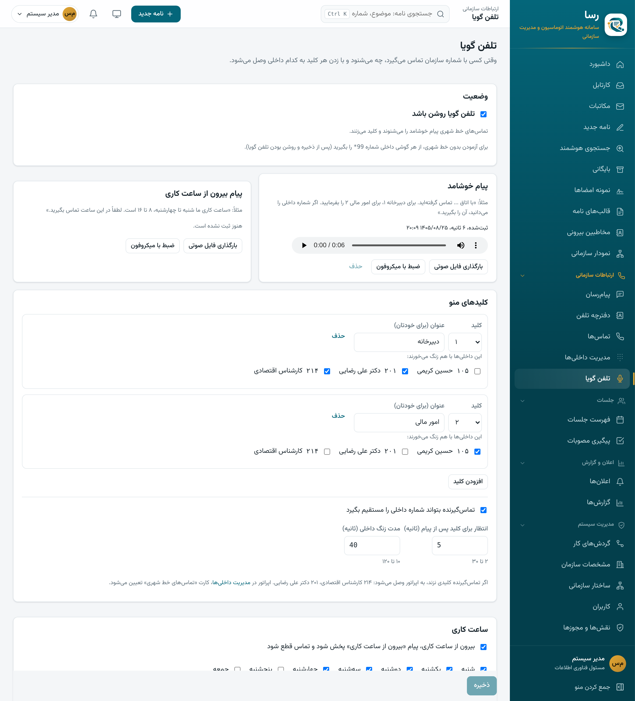

# تلفن رسا: مرکز تلفن Asterisk و خط شهری با گیت‌وی SP5052A

این سند راه‌اندازی بخش تلفن ماژول ارتباطات را توضیح می‌دهد. رسا و مرکز تلفن روی یک سرور در دو کانتینر جدا اجرا می‌شوند. خط‌های شهری از گیت‌وی Micronet SP5052A وارد می‌شوند.

## ۱. معماری

```
گوشی‌های داخلی (IP Phone / نرم‌افزار تلفن)  ──SIP 5060/UDP + RTP──┐
                                                                   ▼
خط شهری ۱ ─┐                                             ┌──────────────────┐   AMI 5038 (فقط شبکه داخلی pbx-net)   ┌────────────┐
خط شهری ۲ ─┴─ FXO ─ SP5052A ──SIP (rasa-trunk)──────────►│ کانتینر pbx       │◄────────────────────────────────────────►│ office-api │◄── مرورگر (فقط HTTPS)
                                                         │ Asterisk 20.6     │   فایل‌های پیکربندی (حجم pbx-config)      └────────────┘
                                                         └──────────────────┘◄─────────────────────────────────────────────
```

- **مالکیت پیکربندی:** رسا فقط دو فایل را می‌سازد: `pjsip_extensions.conf` و `extensions_rasa.conf`. این دو فایل در حجم مشترک `pbx-config` نوشته می‌شوند. پیکربندی ثابت Asterisk در `deploy/pbx/conf` است و Asterisk فقط فایل‌های رسا را include می‌کند.
- **اعمال تغییر:** وقتی داخلی‌ای فعال، معلق یا غیرفعال می‌شود، یا کاربری غیرفعال می‌شود، یا مجوزی تغییر می‌کند، یا مقصد تماس ورودی عوض می‌شود، رسا هر دو فایل را از نو می‌سازد. سپس از طریق AMI فقط `res_pjsip` و `pbx_config` را reload می‌کند.
- **مرورگر:** هرگز به AMI وصل نمی‌شود. «تماس با یک کلیک» از مسیر API می‌گذرد: API → Originate در AMI.
- **سابقه تماس:** رویدادهای AMI در جدول‌های `communication_calls` و `communication_call_events` ثبت می‌شوند. ثبت تکراری اثری ندارد. صدای تماس ضبط نمی‌شود و فایل CDR روی دیسک مرکز تلفن ساخته نمی‌شود.

## ۲. گیت‌وی Micronet SP5052A

- SP5052A یک گیت‌وی SIP با **دو پورت FXO** است، پس دو خط شهری را می‌گیرد. (مدل SP5002 پورت FXS دارد و برای خط شهری مناسب نیست.)
- هر خط شهری به یکی از پورت‌های LINE وصل می‌شود. اگر خط از مودم فیبر (FTTH) می‌آید، از پورت Phone (FXS) مودم وصل می‌شود. سرویس VoIP مودم سر جای خودش می‌ماند.
- پورت LAN گیت‌وی به شبکه داخلی همان سرور رسا وصل می‌شود. بهتر است گیت‌وی IP ثابت داشته باشد.

تنظیمات گیت‌وی در صفحه وب خود دستگاه انجام می‌شود (نام منوها ممکن است با نسخه firmware کمی فرق کند):

| تنظیم | مقدار |
|---|---|
| SIP Proxy / Registrar | آدرس LAN سرور رسا، درگاه 5060 |
| Register | فعال |
| User / Auth ID | `rasa-trunk` |
| Password | همان `PBX_TRUNK_PASSWORD` در `.env` سرور |
| تماس ورودی از خط (PSTN → VoIP، Hot line) | شماره دلخواه، مثلاً `100`. رسا هر شماره‌ای را به «مقصد تماس‌های خط شهری» می‌برد. |
| تماس خروجی (VoIP → PSTN) | بدون پیشوند. رسا پیش از ارسال، ۹ را از شماره حذف می‌کند. |
| Caller ID (CLIP) | فعال، اگر مخابرات شماره تماس‌گیرنده را می‌فرستد |
| Codec | G.711 A-law / μ-law |

## ۳. راه‌اندازی روی سرور

۱. در `.env` سرور این مقدارها را بگذارید:

```
COMPOSE_FILE=docker-compose.yml:docker-compose.pbx.yml
# OFFICE_PBX_AMI_SECRET را deploy/docker-install.sh یک بار می‌سازد؛ دستی نسازید.
PBX_BIND=192.168.1.10              # آدرس LAN همین سرور؛ پیش‌فرض 127.0.0.1 است، یعنی هیچ گوشی‌ای وصل نمی‌شود
PBX_EXTERNAL_ADDRESS=192.168.1.10  # همان آدرس، برای عبور SIP از NAT داکر
PBX_LOCAL_NETS=192.168.1.0/24      # شبکه گوشی‌ها
PBX_TRUNK_PASSWORD=...             # openssl rand -hex 12  (فقط حرف و رقم، دست‌کم ۱۶ نویسه)
PBX_TRUNK_IP=192.168.1.20          # IP ثابت SP5052A
PBX_MAX_OUTBOUND=2                 # دو خط شهری
```

۲. `bash deploy/docker-install.sh` را اجرا کنید، یا `docker compose up -d --build`.

۳. در رسا، صفحه «مدیریت داخلی‌ها»:
   - برای هر کاربر داخلی تعریف کنید و «ایجاد در مرکز تلفن» را بزنید.
   - «رمز جدید گوشی» را بزنید. رمز فقط یک بار نمایش داده می‌شود؛ آن را در گوشی وارد کنید.
   - در کارت «تماس‌های خط شهری» مشخص کنید کدام داخلی‌ها زنگ بخورند.

**هشدار امنیتی:** درگاه‌های 5060 و بازه RTP (پیش‌فرض 10000 تا 10099، UDP) را هرگز روی اینترنت باز نکنید یا روی مودم forward نکنید. مرکز تلفنی که روی اینترنت باز باشد، در چند ساعت هدف حدس رمز و تماس‌های بین‌المللی پرهزینه قرار می‌گیرد. درگاه AMI (5038) اصلاً منتشر نمی‌شود.

## ۴. شماره‌گیری و دسترسی

| شماره | چه کسی | توضیح |
|---|---|---|
| داخلی‌ها (۲ تا ۶ رقم) | همه | زمینه `rasa-internal` |
| `9110`، `9115`، `9125` | همه | پلیس، اورژانس، آتش‌نشانی |
| `9` + شماره ۸ رقمی شهر | دارندگان مجوز `communications.call.external` | زمینه `rasa-external`؛ پیش‌فرض نقش‌های مدیر و رئیس |
| `9` + `0` + ۱۰ رقم (شهرهای دیگر و موبایل) | همان | |
| بین‌المللی (`900…`) و شماره‌های کوتاه ویژه | هیچ‌کس | در dial plan تعریف نشده است، برای جلوگیری از سوءاستفاده تلفنی |

- **سقف همزمانی:** تعداد تماس خروجی همزمان به `PBX_MAX_OUTBOUND` محدود است. تماس بیش از سقف بوق اشغال می‌شنود.
- **مجوزها:** زمینه هر داخلی از مجوز صاحبش ساخته می‌شود. با تغییر نقش یا مجوز، پیکربندی خودکار به‌روز می‌شود.
- **تماس با یک کلیک:** «تماس با یک کلیک» از dial plan خود داخلی تماس‌گیرنده می‌گذرد (`rasa-originate`). پس رسا نمی‌تواند دسترسی کسی را بیشتر کند. API هم همین قاعده‌ها را جداگانه بررسی می‌کند.

## ۵. مجوزهای جدید

- `communications.call.external`: تماس با خط شهری.
- `communications.report.view`: دیدن همه تماس‌ها. بدون این مجوز، هر کس فقط تماس‌های خودش را می‌بیند.
- `communications.settings.manage`: تعیین مقصد تماس‌های ورودی و تنظیم تلفن گویا.

## ۶. رمز SIP

- **ساخت و نگهداری:** رمز هر داخلی ۲۴ نویسه تصادفی است. رسا آن را با `DATA_ENCRYPTION_KEY` رمزنگاری‌شده در پایگاه داده نگه می‌دارد و در فایل پیکربندی مرکز تلفن با دسترسی 0640 می‌نویسد.
- **انحراف آگاهانه از سند مشخصات:** رمز یک بار به مدیر داخلی‌ها نشان داده می‌شود (پاسخ `no-store`) تا آن را در گوشی وارد کند. در مرورگر ذخیره نمی‌شود، در هیچ پاسخ دیگری نمی‌آید و در رویدادنگاری هم ثبت نمی‌شود. فقط خودِ «تعویض رمز» در رویدادنگاری می‌آید.

## ۷. آزمون‌ها

- `apps/office-api/test/telephony.test.ts`: ساخت فایل‌ها، پاک‌سازی نام‌ها، مجوز خط شهری و شماره‌های ممنوع، ثبت تکراری رویدادها و دیدن سابقه تماس.
- آزمون روی Asterisk 20.6 واقعی با همین `deploy/pbx` انجام شد و همه این موارد درست کار کرد:
  - ثبت گوشی
  - تماس داخلی و تماس با یک کلیک
  - تماس خروجی و ورودی، با یک گوشی نرم‌افزاری که نقش گیت‌وی را بازی می‌کرد

## ۸. پیش از استفاده واقعی

- **اتصال گیت‌وی:** هنوز هیچ دستگاه واقعی یا خط شهری به این مرکز تلفن وصل نشده است. نخستین اتصال SP5052A و نخستین تماس واقعی پس از تأیید مدیر سامانه انجام می‌شود.
- **پیام صوتی فارسی:** پیام‌های پیش‌فرض Asterisk («سرویس در دسترس نیست» و «کلید نادرست») فعلاً انگلیسی‌اند. پیام‌های تلفن گویا را خودتان به فارسی ضبط می‌کنید (بخش ۹).

## ۹. تلفن گویا (منشی خودکار خط شهری)

صفحه «ارتباطات سازمانی ← تلفن گویا» (مجوز `communications.settings.manage`).



**مسیر یک تماس خط شهری وقتی تلفن گویا روشن است:**

۱. اگر «ساعت کاری» فعال باشد و الان بیرون از روزها و ساعت‌های کاری باشد (به وقت تهران)، پیام «بیرون از ساعت کاری» پخش می‌شود و تماس قطع می‌شود.
۲. در غیر این صورت پیام خوشامد پخش می‌شود. تماس‌گیرنده می‌تواند همان وسط پیام کلید بزند.
۳. هر کلید منو (۰ تا ۹) داخلی‌های انتخاب‌شده را با هم زنگ می‌زند.
۴. اگر «گرفتن مستقیم شماره داخلی» روشن باشد، تماس‌گیرنده می‌تواند شماره داخلی را هم بگیرد. اگر کلیدی با اول شماره داخلی یکی باشد (مثلاً کلید ۱ و داخلی ۱۰۵)، Asterisk سه ثانیه منتظر رقم بعدی می‌ماند.
۵. اگر کلیدی نزند، به «اپراتور» وصل می‌شود: همان داخلی‌های کارت «تماس‌های خط شهری» در صفحه مدیریت داخلی‌ها. اگر اپراتوری تعیین نشده باشد، پیام «سرویس در دسترس نیست» پخش می‌شود.
۶. کلید نادرست: پیام «نادرست» و پخش دوباره پیام خوشامد؛ بعد از سه بار، اپراتور.

از خط شهری فقط به داخلی‌ها می‌شود رسید. هیچ راهی از تلفن گویا به خط شهری بیرونی نمی‌رود (جلوگیری از سوءاستفاده تلفنی).

**پیام‌ها:**

- «بارگذاری فایل صوتی» هر فایلی را که مرورگر بخواند (MP3، WAV، OGG، M4A) می‌پذیرد. مرورگر آن را به WAV تک‌کاناله ۸ کیلوهرتز تبدیل می‌کند، چون Asterisk همین را بدون تبدیل پخش می‌کند. سرور هم قالب را دوباره بررسی می‌کند. بیشینه سه دقیقه.
- «ضبط با میکروفون» فقط وقتی رسا با HTTPS باز شده باشد کار می‌کند، چون مرورگر روی HTTP اجازه میکروفون نمی‌دهد. روی HTTP فایل را با گوشی یا رایانه ضبط کنید و بارگذاری کنید.
- پیام‌ها در پایگاه داده (جدول `communication_sounds`) نگه داشته می‌شوند. رسا آن‌ها را در `sounds/` حجم `pbx-config` می‌نویسد. پس پشتیبان‌گیری عادی رسا آن‌ها را هم دارد.
- تا پیام خوشامد ثبت نشده، تلفن گویا روشن نمی‌شود. تا تلفن گویا روشن است، پیام خوشامد حذف نمی‌شود.

**آزمودن بدون خط شهری:** وقتی تلفن گویا روشن است، از هر گوشی داخلی شماره `*99` را بگیرید. دقیقاً همان چیزی را می‌شنوید که تماس‌گیرنده بیرونی می‌شنود.

**آزمون‌ها:** `apps/office-api/test/ivr.test.ts`. روی Asterisk 20.6 واقعی هم بررسی شد: پخش پیام خوشامد، کلید منو، گرفتن مستقیم داخلی، کلید نادرست و تکرار، انتظار و وصل به اپراتور، پیام بیرون از ساعت کاری، و `*99`.
