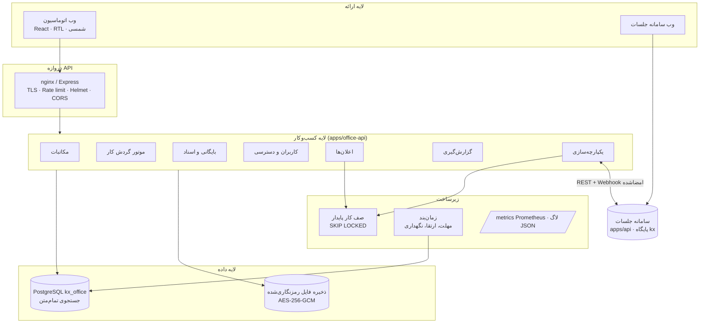

# ۱. معماری

## لایه‌ها

## ماژول‌ها و نگاشت به سند معماری

| بخش سند | پیاده‌سازی |
|---|---|
| **مکاتبات**: وارده/صادره/داخلی، شماره‌گذاری خودکار، بارکد/QR، پیوست نسخه‌دار، جستجوی پیشرفته | `routes/letters.ts`، `services/letters.ts`، `lib/barcode.ts`. شماره به‌شکل `و/۱۴۰۵/۰۰۰۰۱` (و=وارده، ص=صادره، د=داخلی) با شمارنده سالانه شمسی بدون شکاف (قفل ردیف). کد رهگیری ۱۲ رقمی، بارکد Code128 و QR به صفحه عمومی صحت‌سنجی `/verify/<کد>`. پیوست‌ها گروه نسخه دارند. جستجو: `tsvector` روی موضوع، متن، خلاصه، طرفین و شماره‌ها با نرمال‌سازی ی/ک عربی، ارقام فارسی و نیم‌فاصله (`fa_normalize`). |
| **موتور گردش کار** (BPMN-Lite): ارجاع، بررسی، تأیید، امضا، بایگانی؛ مهلت، یادآوری، ارتقا؛ نسخه‌بندی | `services/workflow.ts`، `routes/workflows.ts`، `services/scheduler.ts`. تعریف JSON با گام‌های `review/approve/sign/archive/notify`، مسئول بر اساس کاربر، سمت، نقش، مدیر واحد، مدیر واحد صاحب نامه، مدیر شروع‌کننده یا کاربر متن (مثل مسئول مصوبه)؛ شرط اجرا، بازگشت در صورت رد، مهلت ساعتی، یادآوری در ۸۰٪ مهلت و ارتقا به مدیر. هر ذخیره نسخه جدید می‌سازد و نمونه‌های جاری روی نسخه خود ادامه می‌دهند. ارجاع آزاد (کارتابل) هم جداگانه وجود دارد. |
| **بایگانی**: ساختار درختی، نسخه‌بندی، امضای دیجیتال، نگهداری و امحا | `routes/archive.ts`، `services/archive.ts`، `services/signatures.ts`. سیاست نگهداری از پرونده بالادستی ارث می‌رسد؛ امحا پیش از موعد فقط با `force` و هرگز در «توقیف قانونی»؛ پس از امحا محتوای فایل حذف و فراداده برای ممیزی می‌ماند. امضای Ed25519 روی هش محتوای نامه و پیوست‌ها (یا هش نسخه سند)؛ کلید خصوصی هر کاربر رمزنگاری‌شده نگهداری می‌شود؛ تغییر محتوا پس از امضا تشخیص داده می‌شود. |
| **کاربران و دسترسی**: واحد، سمت، RBAC+ABAC، 2FA، لاگ | `routes/org.ts`، `auth/*`، `services/access.ts`. ۲۲ مجوز در ۶ نقش پیش‌فرض؛ هر انتساب نقش می‌تواند به یک واحد (و زیرمجموعه‌هایش) محدود شود. ABAC: سطح طبقه‌بندی کاربر (عادی/محرمانه/سری) در برابر طبقه نامه، مشارکت در نامه (ایجادکننده، گیرنده، ارجاع، گام گردش) و واحد صاحب نامه. نامه نامرئی پاسخ ۴۰۴ می‌دهد. TOTP با الزام برای نقش‌های مشخص (`MFA_REQUIRED_ROLES`)، توکن دسترسی ۱۵ دقیقه‌ای و توکن تمدید چرخشی با تشخیص استفاده مجدد. |
| **اعلان‌ها**: درون‌برنامه، ایمیل، پیامک، قالب، صف | `services/notifications.ts`، `services/jobs.ts`. ۱۰ رویداد با قالب قابل ویرایش در هر کانال؛ ارسال ایمیل (SMTP) و پیامک (کاوه‌نگار) از صف با تلاش مجدد. |
| **گزارش‌گیری**: KPI، Excel/PDF | `routes/reports.ts`، `lib/xlsx.ts`. حجم نامه‌ها به تفکیک نوع/وضعیت/منبع، روند ۱۲ ماه شمسی، ارجاعات معوق، میانگین و صدک ۹۰ زمان پاسخ، عملکرد واحدها، گردش‌ها و ارتقاها، مصوبات معوق. خروجی Excel راست‌به‌چپ و CSV (ایمن در برابر Formula Injection)؛ PDF با چاپ مرورگر. |
| **یکپارچه‌سازی**: API Gateway، کلید/توکن، جلسات، مالی، CRM | `routes/integration.ts`، `integration/meetings.ts`. اتصال کامل به سامانه جلسات (فصل ۳)، درگاه دریافت نامه با کلید API برای ایمیل/اسکن/سامانه‌های دیگر. جدول `integrations` انواع `accounting`، `crm` و `government` را برای اتصال‌های بعدی پیش‌بینی کرده است. |
| **الزامات غیرعملکردی** | فارسی و راست‌به‌چپ، تقویم شمسی (`@kx/shared`)، Helmet/CSP، محدودیت نرخ، اعتبارسنجی zod، بررسی نوع واقعی فایل (magic bytes)، رمزنگاری AES-256-GCM فایل‌ها و اسرار، لاگ ممیزی زنجیره هش غیرقابل‌تغییر (تریگر پایگاه داده)، متریک Prometheus، لاگ ساختاریافته pino. |

## جایگزین‌ها نسبت به فناوری‌های پیشنهادی سند

سند در چند جا فناوری مشخصی پیشنهاد کرده است. برای اینکه سامانه با پشته موجود مخزن (Node/PostgreSQL) یکدست بماند و روی یک سرور قابل نصب باشد، معادل‌های زیر انتخاب شد؛ همه پشت رابط مشخص هستند و قابل جایگزینی‌اند:

| پیشنهاد سند | پیاده‌سازی فعلی | چرا / مسیر ارتقا |
|---|---|---|
| Elasticsearch | جستجوی تمام‌متن PostgreSQL با نرمال‌سازی فارسی | بدون سرویس اضافه؛ برای چند میلیون نامه کافی است. |
| RabbitMQ / Kafka | صف کار پایدار در PostgreSQL (`jobs` با `FOR UPDATE SKIP LOCKED`) و Outbox تراکنشی در سامانه جلسات | تحویل حداقل‌یک‌بار با تلاش مجدد نمایی؛ رویدادها با شناسه یکتا تکرارناپذیرند. |
| MinIO / S3 | ذخیره محلی رمزنگاری‌شده پشت `lib/storage.ts` | افزودن درایور S3 بدون تغییر بقیه کد. |
| Keycloak | احراز هویت داخلی JWT + TOTP، و OAuth2 Client Credentials برای سامانه‌ها | برای SSO می‌توان OIDC را به همین لایه افزود. |
| HSM / گواهی امضای دیجیتال ملی | Ed25519 با کلید رمزنگاری‌شده در پایگاه داده | امضای سازمانی و قابل راستی‌آزمایی؛ برای اعتبار حقوقی می‌توان کلید را به HSM یا توکن امضای ملی منتقل کرد. |
| موتور گزارش‌ساز (Jasper و مانند آن) | API گزارش + خروجی XLSX/CSV داخلی و چاپ PDF مرورگر | بدون وابستگی سنگین. |
| OCR اسکن | ثبت اسکن با منبع «اسکن» و پیوست | OCR را می‌توان به‌عنوان مصرف‌کننده صف `jobs` اضافه کرد. |

## جریان‌های اصلی

**نامه وارده:** دبیرخانه ثبت می‌کند (شماره، بارکد) ← ارجاع به سمت مدیر واحد ← مدیر به کارشناس ارجاع می‌دهد و ارجاع خودش بسته می‌شود ← کارشناس پاسخ می‌دهد ← بایگانی در پرونده واحد. یا گردش «رسیدگی به نامه وارده».

**نامه صادره:** کارشناس پیش‌نویس می‌کند ← دبیرخانه شماره می‌دهد ← گردش «تأیید و امضای نامه صادره»: مدیر شروع‌کننده تأیید ← رئیس امضا (امضای دیجیتال خودکار) ← دبیرخانه ارسال را ثبت می‌کند. ارسال پیش از پایان گردش یا بدون امضا ممکن نیست؛ نامه امضاشده قابل ویرایش نیست.
