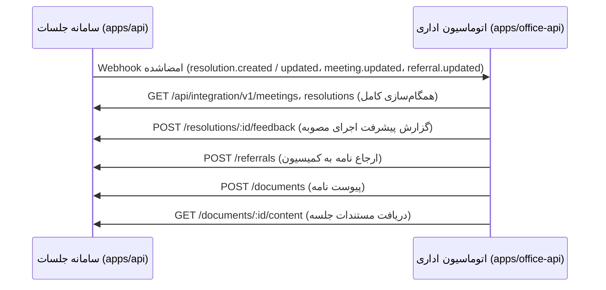

# ۳. یکپارچگی با سامانه جلسات

دو سامانه مستقل‌اند و هر کدام بدون دیگری کار می‌کند. یکپارچگی دوطرفه است:



## سمت سامانه جلسات

- **سامانه‌های خارجی** در منوی «ساختار ← یکپارچه‌سازی» (فقط مدیر) تعریف می‌شوند. هر سامانه به یک اتاق محدود است و کلید API، Client Secret و Webhook Secret می‌گیرد که فقط یک بار نمایش داده می‌شوند (قابل چرخش).
- **احراز هویت:** هدر `X-Api-Key` یا OAuth2 Client Credentials: `POST /api/integration/v1/oauth/token` با `grant_type=client_credentials` و دریافت Bearer token.
- **دامنه‌ها (scopes):** `meetings:read`، `resolutions:read`، `resolutions:feedback`، `referrals:write`، `documents:read`، `documents:write`، `events:read`.
- **رویدادها:** `resolution.created`، `resolution.updated`، `meeting.updated`، `referral.updated`، `meeting.invitation_letters_requested` (یا `*`). رویدادها در همان تراکنش تغییر داده در Outbox ثبت و با تلاش مجدد نمایی ارسال می‌شوند؛ مدیر می‌تواند تاریخچه را ببیند و ارسال ناموفق را دوباره بفرستد. `GET /events` برای دریافت رویدادها به‌صورت pull هم هست.
- **بازخورد مصوبه:** درصد پیشرفت و توضیح، با `source = integration` در تاریخچه مصوبه ثبت می‌شود (برچسب «سامانه خارجی»). درصد ۱۰۰ وضعیت را «گزارش‌شده» می‌کند و دبیر مثل بازخورد داخلی تأیید یا رد می‌کند.

## امضای Webhook

```
x-kx-event: resolution.created
x-kx-delivery: <شناسه رویداد>
x-kx-signature: t=<unix seconds>,v1=<hex HMAC_SHA256(secret, "<t>.<raw body>")>
```

گیرنده امضا را با مقایسه زمان‌ثابت بررسی می‌کند و درخواست‌های قدیمی‌تر از ۵ دقیقه را رد می‌کند. شناسه رویداد (در بدنه و هدر `x-kx-delivery`) در `integration_inbox` یکتاست، پس تحویل تکراری اثری ندارد. پردازش در صف انجام می‌شود و پاسخ Webhook فوراً `202` است.

## سمت اتوماسیون

صفحه «یکپارچه‌سازی» (مجوز `integration.manage`) آدرس سامانه جلسات، روش احراز هویت، اسرار، دامنه نگاشت‌ها (کمیسیون ← واحد، کاربر ← کاربر از راه ایمیل) و کلید گردش کار پیش‌فرض را نگه می‌دارد، اتصال را آزمایش می‌کند، همگام‌سازی کامل را اجرا می‌کند و صندوق رویدادهای دریافتی را با امکان پردازش مجدد نشان می‌دهد. اسکریپت `connect-meetings` همه این کارها را خودکار انجام می‌دهد.

## سناریوهای سند معماری

**۱. مصوبه ← نامه و گردش کار.** با ثبت مصوبه در سامانه جلسات، رویداد `resolution.created` می‌رسد. اتوماسیون مصوبه و جلسه را در حافظه محلی ذخیره می‌کند، یک نامه داخلی «ابلاغ مصوبه» با شماره و پیوند به جلسه می‌سازد و گردش «پیگیری اجرای مصوبه» را برای مسئول تطبیق‌یافته (یا مدیر واحد نگاشت‌شده) شروع می‌کند. مهلت گام از سررسید مصوبه گرفته می‌شود.

**۲. نامه ← کمیسیون.** از صفحه نامه، «ارجاع به کمیسیون»، کمیسیون (و در صورت نیاز جلسه) را انتخاب می‌کند. نامه و پیوست‌هایش به سامانه جلسات فرستاده می‌شود و آنجا به‌عنوان «ارجاع از اتوماسیون» در دستور کار پیشنهادی قرار می‌گیرد. درخواست با `externalRef` (شناسه نامه) تکرارناپذیر است و ارسال دوباره همان ارجاع قبلی را برمی‌گرداند و تغییر وضعیت ارجاع (پذیرش، در دستور جلسه، رسیدگی‌شده) با `referral.updated` برمی‌گردد.

**۳. بازخورد اجرا.** هر اقدام روی گام پیگیری (ثبت پیشرفت، تکمیل) به‌صورت بازخورد به سامانه جلسات فرستاده می‌شود؛ تکمیل گردش پیشرفت ۱۰۰٪ را ثبت می‌کند. وقتی دبیر کمیسیون مصوبه را «انجام‌شده» اعلام کند، رویداد `resolution.updated` وضعیت را در اتوماسیون هم به‌روز می‌کند. ارسال بازخورد ناموفق در صف دوباره تلاش می‌شود.

**۴. نامه دعوت جلسه.** دبیر کمیسیون در سامانه جلسات، زبانه «مدعوین» جلسه، دکمه «نامه دعوت در اتوماسیون اداری» را می‌زند، مدعوین را انتخاب می‌کند و در صورت نیاز توضیحی اضافه می‌کند (`POST /api/meetings/{id}/invitation-letters`، مجوز `meeting.manage`، فقط برای جلسه زمان‌بندی‌شده). رویداد `meeting.invitation_letters_requested` برای سامانه‌های متصل ثبت می‌شود و اگر هیچ سامانه‌ای مشترک نباشد درخواست با `409` رد می‌شود. اتوماسیون برای هر مدعو یک پیش‌نویس نامه صادره با متن آماده (کمیسیون، شماره و عنوان جلسه، تاریخ شمسی، ساعت، مکان، دستور جلسه و پیوند برخط) می‌سازد و به دبیرخانه اعلان می‌دهد تا شماره، امضا و ارسال کند. برای مدعوی که نامه لغونشده دارد نامه تکراری ساخته نمی‌شود. همین کار از صفحه جلسه در اتوماسیون («ساخت نامه دعوت»، مجوز `letter.register_outgoing`) هم ممکن است و فهرست نامه‌های دعوت با وضعیتشان همان‌جا دیده می‌شود.

همه این سناریوها در `apps/office-api/test/meetings-e2e.test.ts` با اجرای واقعی API سامانه جلسات آزموده می‌شوند.

## درگاه دریافت نامه

`POST /api/intake/letters` با هدر `X-Api-Key` (تعریف در همان صفحه) به سامانه‌های ایمیل، اسکن یا سامانه‌های دیگر امکان می‌دهد نامه وارده با پیوست ثبت کنند. نامه با منبع مربوط در کارتابل دبیرخانه قرار می‌گیرد.
