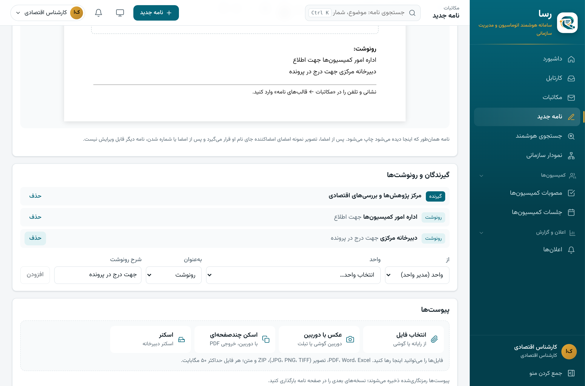
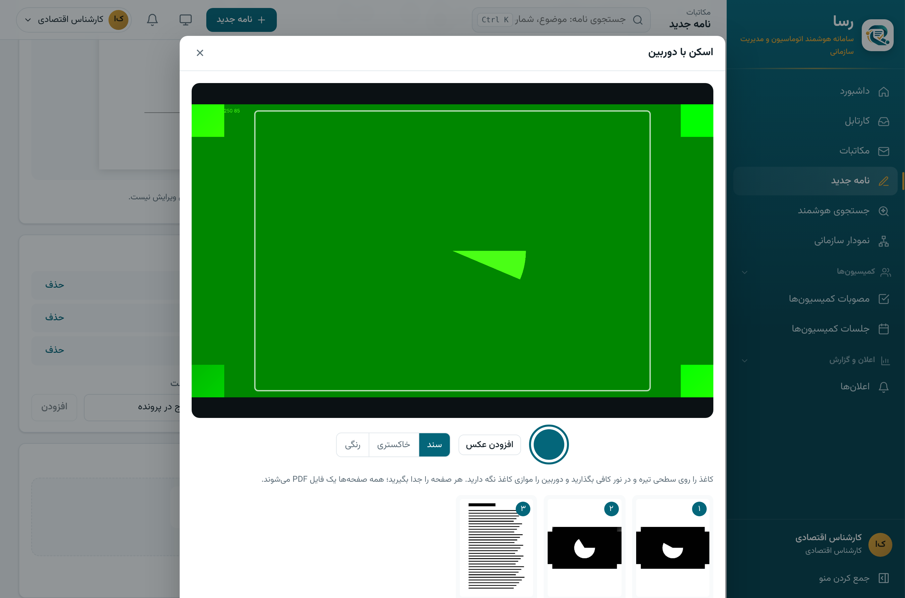
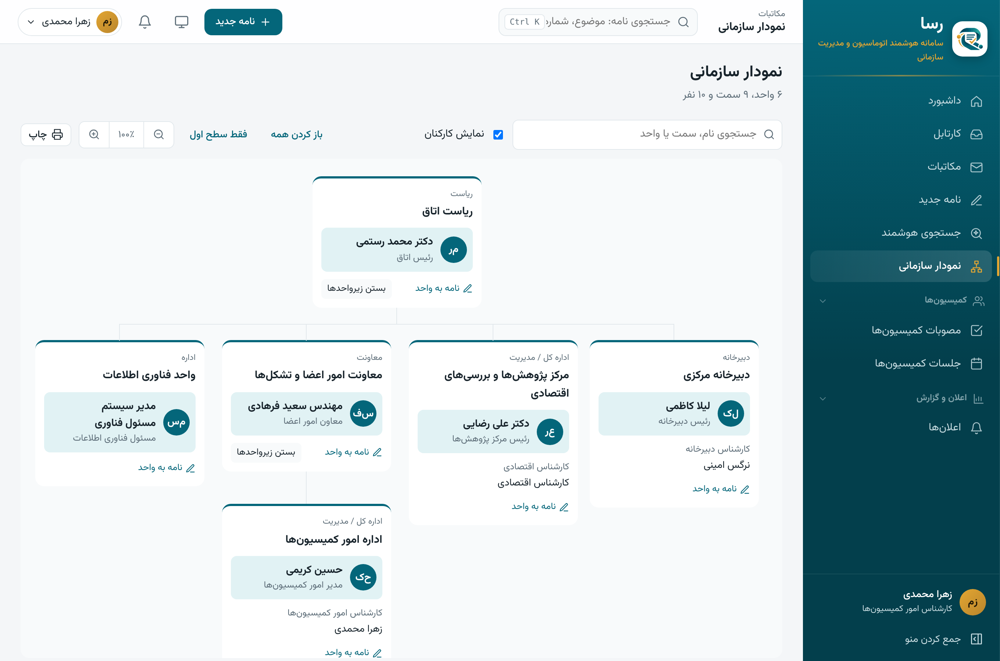

# رونوشت، نامه داخلی، پیوست از دوربین و اسکنر، نمودار سازمانی

## نامه داخلی و رونوشت

- در «نامه جدید» سه زبانه هست: **نامه داخلی**، **نامه صادره**، **ثبت نامه وارده**.
- نامه داخلی «گیرنده» و «رونوشت» دارد (شخص، سمت یا واحد؛ واحد به سمت مدیر آن می‌رسد). نامه صادره و وارده **رونوشت داخلی** دارند.
- هر رونوشت «شرح» دارد (جهت اطلاع، جهت استحضار، جهت اقدام، …) که زیر نامه چاپ می‌شود.
- نامه صادره **رونوشت بیرونی** هم دارد: از مخاطبین بیرونی یا با نوشتن نام سازمان.
- تحویل: نامه داخلی و وارده هنگام ثبت (شماره‌گذاری)، نامه صادره هنگام ارسال به کارتابل گیرندگان می‌رسد؛ گیرنده با اقدام «اقدام» و رونوشت با اقدام «اطلاع». تا پیش از تحویل، گیرنده نامه را نمی‌بیند. افزودن رونوشت به نامه وارده ثبت‌شده فقط رونوشت‌های تازه را تحویل می‌دهد.
- در صفحه نامه دکمه **ارسال رونوشت** همان ارجاع «جهت اطلاع» است برای فرستادن رونوشت نامه موجود به هر کس.

## پیوست‌ها

| روش | کجا کار می‌کند | خروجی |
|---|---|---|
| انتخاب فایل / کشیدن و رها کردن | همه دستگاه‌ها | خود فایل |
| عکس با دوربین | گوشی و تبلت (`capture`)؛ در رایانه پنجره انتخاب فایل | JPG (منبع «اسکن») |
| اسکن چندصفحه‌ای | هر دستگاه دارای دوربین؛ **فقط روی HTTPS** | یک PDF؛ حالت «سند» کاغذ را سفید و متن را تیره می‌کند؛ چرخش، جابه‌جایی و حذف صفحه |
| اسکنر | اسکنرهای شبکه با eSCL (AirScan) | یک PDF از همه صفحه‌ها (شیشه، سینی، دورو) |

### راه‌اندازی اسکنر

مرورگر به‌تنهایی به درایور TWAIN/WIA دسترسی ندارد؛ برای همین سامانه به‌جای افزونه یا برنامه محلی، از پروتکل استاندارد **eSCL** استفاده می‌کند که بیشتر اسکنرها و دستگاه‌های چندکاره شبکه‌ای (HP، Canon، Epson، Brother، Kyocera، Ricoh، Xerox) دارند.

1. «مدیریت سیستم ← یکپارچه‌سازی ← اسکنرهای شبکه»: نام و نشانی اسکنر (مثلاً `http://192.168.1.40`) را وارد کنید و «آزمون اتصال» را بزنید.
2. سرور اتوماسیون باید به نشانی اسکنر در شبکه دسترسی داشته باشد (اگر سرور بیرون از شبکه سازمان است، از VPN یا یک مسیر شبکه استفاده کنید).
3. **اسکنر USB:** روی یک رایانه کوچک لینوکسی (مثلاً Raspberry Pi) که اسکنر به آن وصل است، [AirSane](https://github.com/SimulPiscator/AirSane) را نصب کنید؛ اسکنر را با eSCL در شبکه منتشر می‌کند و همان نشانی را در سامانه وارد کنید.
4. اگر هیچ‌کدام ممکن نیست: با نرم‌افزار خود اسکنر در پوشه اسکن کنید و فایل را با «انتخاب فایل» یا کشیدن و رها کردن پیوست کنید.

هر اسکنر در یک زمان یک کار انجام می‌دهد؛ خطای آخر برای واحد فناوری در همان جدول دیده می‌شود.

## نمودار سازمانی

منوی «نمودار سازمانی» برای همه کاربران است (فقط خواندنی): واحدها از بالا به پایین با مدیر و کارکنان، جستجوی نام/سمت/واحد، بستن زیرواحدها، بزرگنمایی و چاپ. روی گوشی به‌صورت فهرست تو‌در‌تو نمایش داده می‌شود. کلیک روی نام هر شخص یا «نامه به واحد» یک نامه داخلی با همان گیرنده باز می‌کند. ویرایش ساختار همچنان در «مدیریت سیستم ← ساختار سازمانی» است.

