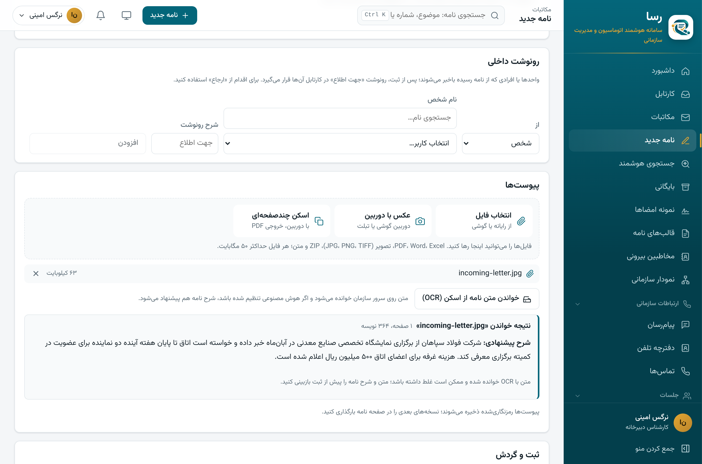
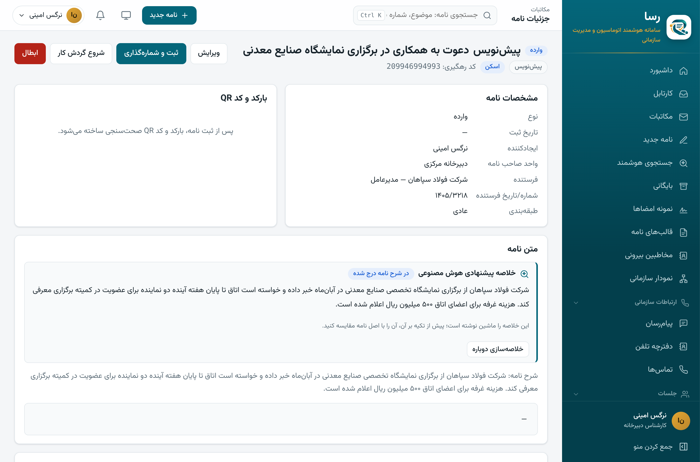
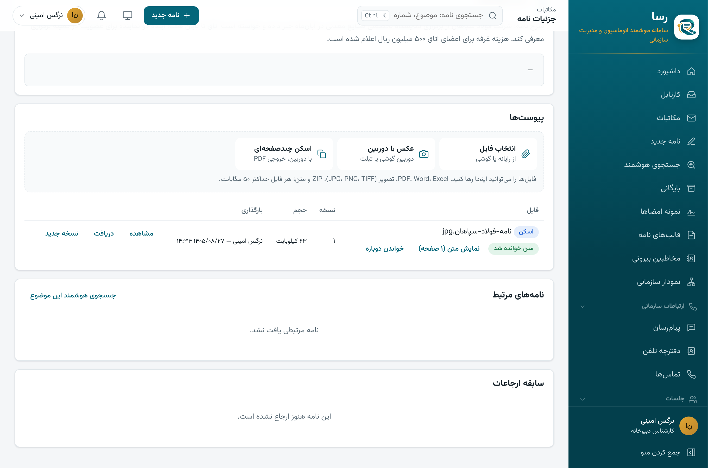
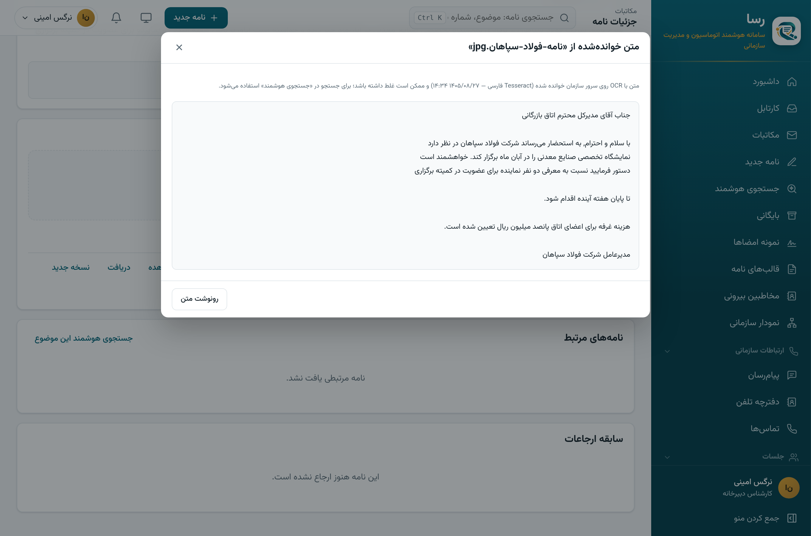

# OCR و خلاصه خودکار نامه وارده

متن نامه‌های وارده‌ای که اسکن یا پیوست می‌شوند (PDF، PNG، JPG، TIFF) **روی سرور خود سازمان** با OCR فارسی خوانده می‌شود و هیچ فایلی برای خواندن به بیرون فرستاده نمی‌شود. اگر در «یکپارچه‌سازی» هوش مصنوعی (مدل گفتگو) تعریف شده باشد، از روی همین متن یک خلاصه دو تا سه جمله‌ای برای **شرح نامه** پیشنهاد می‌شود.

## در عمل

**هنگام ثبت نامه وارده** (نامه جدید ← ثبت نامه وارده):

1. اسکن نامه را با اسکنر، دوربین یا انتخاب فایل در بخش «پیوست‌ها» اضافه کنید.
2. دکمه **«خواندن متن نامه از اسکن (OCR)»** را بزنید. چند ثانیه برای هر صفحه طول می‌کشد.
3. اگر «متن نامه» و «شرح نامه» خالی باشند، با متن خوانده‌شده و خلاصه پیشنهادی پر می‌شوند؛ اگر چیزی نوشته باشید دست نمی‌خورد و نتیجه با دکمه‌های «جایگزینی…» و «درج در شرح نامه» پیشنهاد می‌شود.
4. متن و شرح را بازبینی کنید و نامه را ثبت کنید.

**پس از ذخیره نامه** (یا برای نامه‌هایی که از ایمیل یا API می‌رسند): هر پیوست PDF یا تصویر نامه وارده در پس‌زمینه خوانده می‌شود. در صفحه نامه کنار هر پیوست وضعیت آن دیده می‌شود («در حال خواندن متن…»، «متن خوانده شد» با دکمه نمایش متن، یا خطا با دکمه «خواندن دوباره»). وقتی همه پیوست‌ها خوانده شدند:

- متن آن‌ها در **جستجوی هوشمند** جستجو می‌شود (نامه‌ای که فقط تصویر دارد با کلمات داخل تصویر پیدا می‌شود).
- اگر هوش مصنوعی تنظیم شده و نامه **طبقه‌بندی‌نشده** است، خلاصه ساخته می‌شود و در کادر «خلاصه پیشنهادی هوش مصنوعی» بالای متن نامه می‌آید. اگر شرح نامه خالی باشد در آن هم درج می‌شود؛ **شرحی که کاربر نوشته یا ویرایش کرده هرگز جایگزین نمی‌شود** و خلاصه فقط پیشنهاد می‌شود («درج در شرح نامه»، «خلاصه‌سازی دوباره»).
- درج خلاصه در گزارش رویدادها با عنوان «خلاصه‌سازی نامه با هوش مصنوعی» ثبت می‌شود.

## محرمانگی

- OCR همیشه روی سرور سازمان انجام می‌شود؛ متن خوانده‌شده رمزنگاری‌نشده در پایگاه داده کنار پیوست ذخیره می‌شود (مانند متن خود نامه‌ها).
- **نامه طبقه‌بندی‌شده (محرمانه و بالاتر) هرگز به هوش مصنوعی فرستاده نمی‌شود**؛ فقط OCR محلی روی آن انجام می‌شود. این قاعده هنگام ارسال و دوباره هنگام ذخیره خلاصه بررسی می‌شود، تا اگر نامه در همان لحظه طبقه‌بندی شد خلاصه ذخیره نشود.
- در فرم ثبت، سطح محرمانگی را **پیش از** زدن دکمه OCR تعیین کنید؛ برای نامه طبقه‌بندی‌شده فقط متن خوانده می‌شود.
- بهتر است مدل هوش مصنوعی روی سرور خود سازمان اجرا شود (مثلاً Ollama با یک مدل چندزبانه؛ [deploy/ai](../../deploy/ai/README.md)).

## کیفیت

- روی اسکن تمیز تایپی با وضوح ۲۰۰ تا ۳۰۰ DPI نتیجه خوب است. دستخط، مهر، امضا، جدول‌های پیچیده و اسکن کج یا کم‌نور خوب خوانده نمی‌شوند.
- PDF همیشه از روی تصویر صفحه‌ها خوانده می‌شود، حتی اگر متن داشته باشد؛ چون متن داخلی بسیاری از PDFهای فارسی به‌هم‌ریخته است (مثلاً «لا» به‌صورت «ال» درمی‌آید). فقط اگر از تصویر چیزی خوانده نشود، متن داخلی PDF به کار می‌رود.
- حداکثر ۱۰ صفحه اول هر فایل خوانده می‌شود.
- خلاصه را ماشین نوشته است؛ پیش از تکیه بر آن با اصل نامه مقایسه کنید.

## نصب و پیکربندی

بسته‌های لازم: `tesseract-ocr`، داده زبان فارسی (`tesseract-ocr-fas` در Debian/Ubuntu، `tesseract-ocr-data-fas` در Alpine) و `poppler-utils`.

- **Docker:** در ایمیج `office-api` نصب شده‌اند؛ کافی است ایمیج دوباره ساخته شود (`docker compose build office-api && docker compose up -d office-api`).
- **نصب مستقیم (`deploy/install.sh`):** نصب‌کننده آن‌ها را نصب می‌کند. روی سروری که قبلاً نصب شده:
  `sudo apt-get install -y tesseract-ocr tesseract-ocr-fas poppler-utils` و سپس راه‌اندازی دوباره سرویس.
- اگر نصب نباشند سامانه مثل قبل کار می‌کند و دکمه OCR نمایش داده نمی‌شود.

| متغیر محیطی | پیش‌فرض | توضیح |
|---|---|---|
| `OCR_ENABLED` | `true` | با `false` خاموش می‌شود |
| `OCR_LANGS` | `fas` | زبان‌های Tesseract (مثلاً `fas+eng` برای نامه‌های دوزبانه؛ متن فارسی خالص با `fas` تنها بهتر خوانده می‌شود) |
| `OCR_MAX_PAGES` | `10` | حداکثر صفحه خوانده‌شده از هر PDF |
| `OCR_DPI` | `200` | وضوح تصویر صفحه‌های PDF برای OCR |
| `OCR_TIMEOUT_SECONDS` | `180` | حداکثر زمان خواندن یک فایل |

وضعیت نصب: `GET /api/ocr/status`.

## API

| مسیر | کار |
|---|---|
| `POST /api/letters/ocr` | خواندن یک فایل پیش از ذخیره نامه (فرم ثبت)؛ فیلدها: `file`، `confidentiality`، `subject`، `externalOrg`، `externalParty`؛ پاسخ: `text`، `pages`، `method`، `summary`، `summaryNote`. فقط دارنده مجوز ثبت نامه وارده. |
| `GET /api/letters/:id/attachments/:attId/text` | متن خوانده‌شده یک پیوست |
| `POST /api/letters/:id/attachments/:attId/ocr` | خواندن دوباره یک پیوست |
| `POST /api/letters/:id/ai-summary` | خلاصه تازه؛ شرح نامه فقط اگر خالی باشد پر می‌شود |

مدل داده: ستون‌های `ocr_status`، `ocr_text`، `ocr_method`، `ocr_pages`، `ocr_error`، `ocr_at` در `letter_attachments` و `ai_summary`، `ai_summary_at` در `letters` (مهاجرت `011_ocr.sql`).

## تصویرها

| | |
|---|---|
|  |  |
|  |  |
